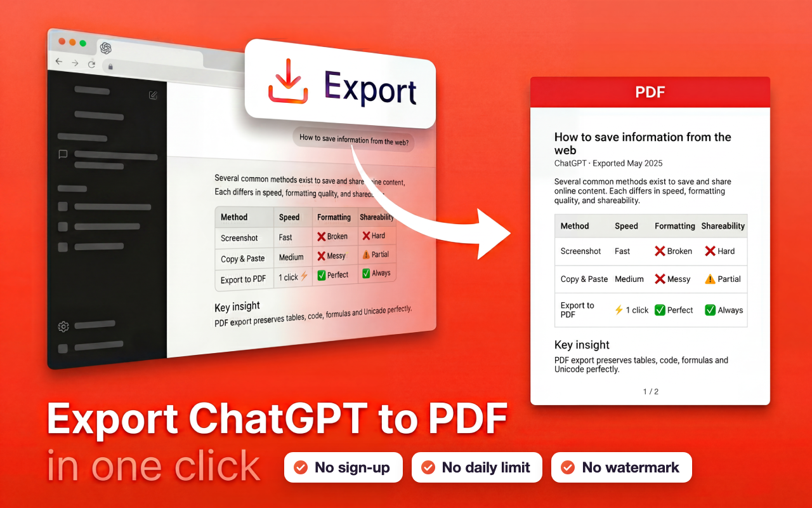
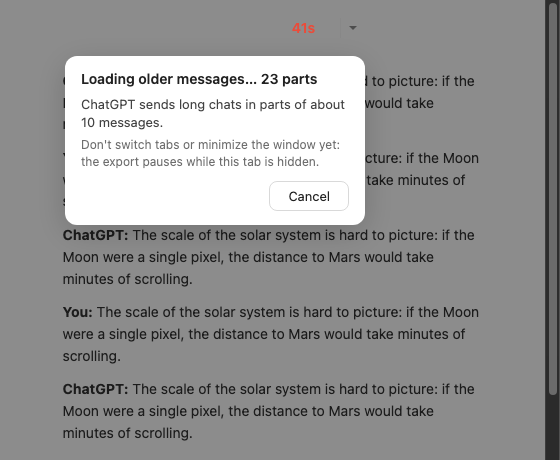
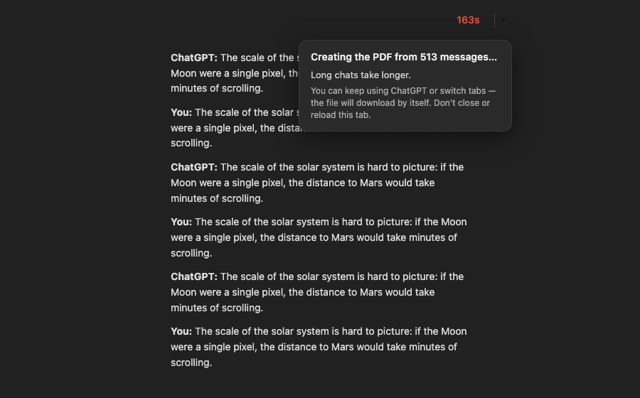
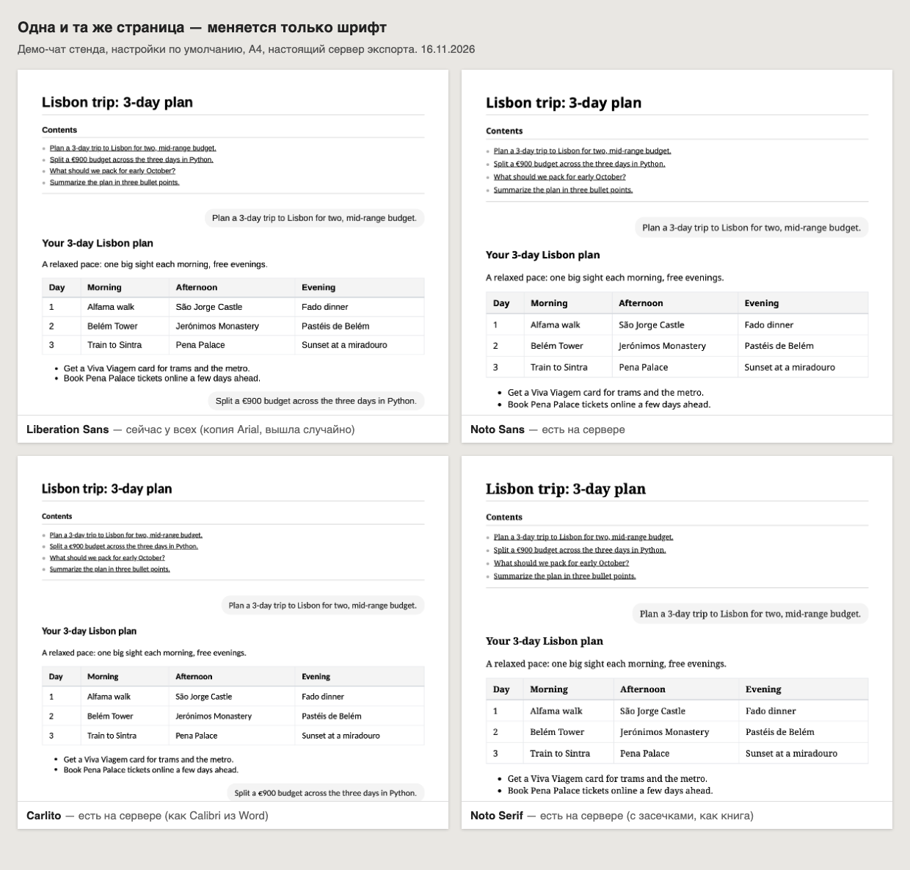
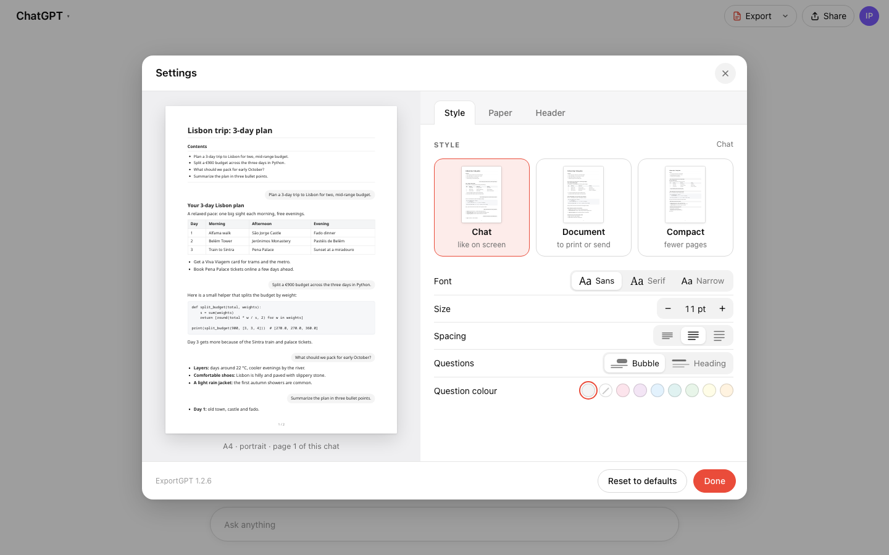
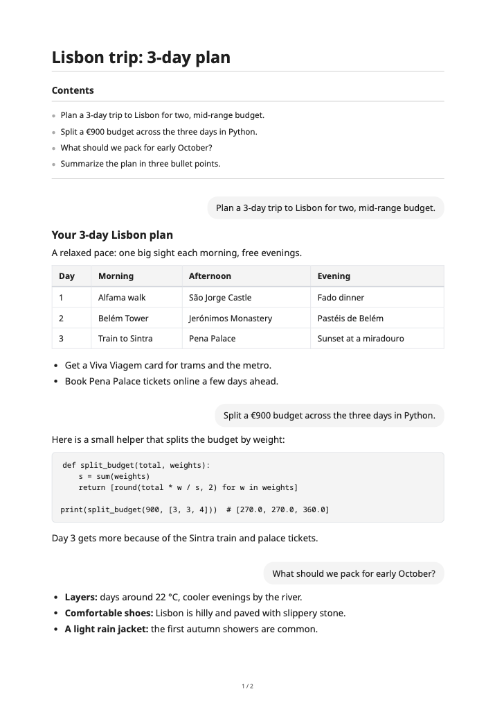
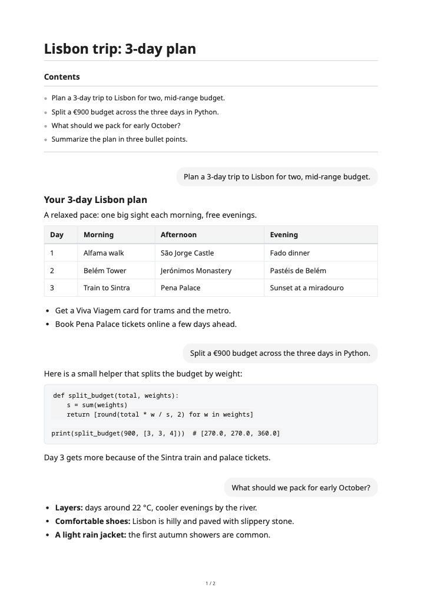
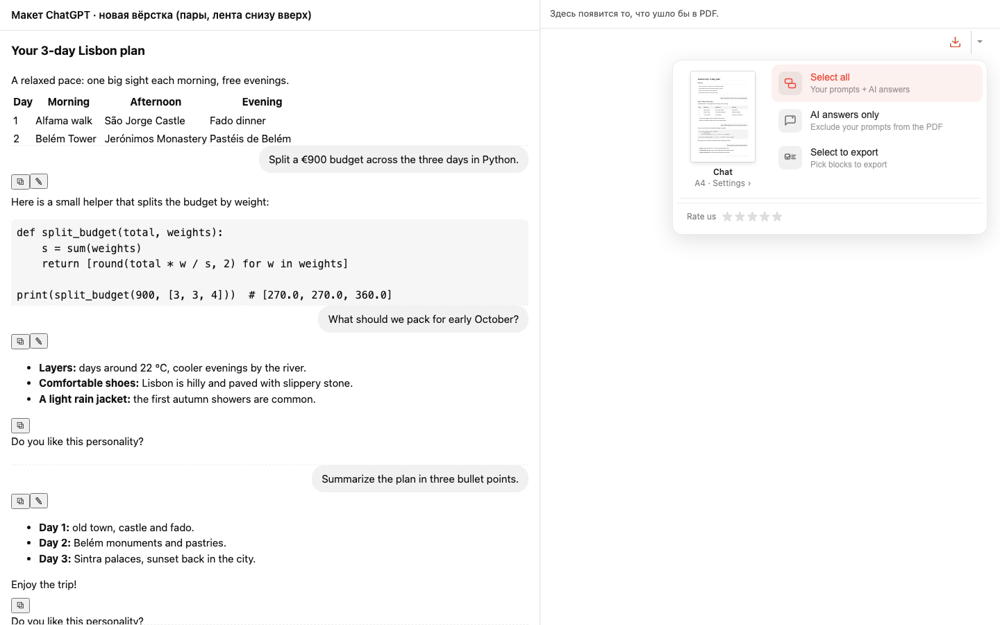
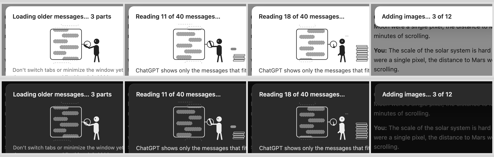

# Журнал дизайна

Кадры, слова автора и решения по внешнему виду продукта и его страниц. Заведён 2026-09-28 — с первой правки,
которую ведём по правилу журнала. Подробные «почему» — в `DECISIONS.md`, здесь — то, что видит глаз.
Кадры — `dizajn/kadry/`.

---

## 2026-09-28 — Страница удаления: форма в карточке-наклейке

**Слово автора** (ведро 28.09, из сессии fib): «встроить Google-форму „почему удалили“ в дизайн страниц других продуктов
так же красиво, как на fib-pages/uninstall»; сегодня — «да, делай — счётчик на ЭкспортГПТ — нет, не нужно пока».
**Было:** серая карточка без лица, сверху мелкая подпись «EXPORT CHATGPT», форма, внизу «Reinstall the extension».
**Стало** (`exportgpt-pages/uninstall.html`, адрес страницы прежний): светлое поле, как у welcome; заголовок по образцу
fib — иконка продукта (настоящая, `icons/icon128.png` → `exportgpt-pages/icon.png`, чуть погашена и наклонена) и
«Export ChatGPT Conversation was removed», просьба одной строкой; форма в белой карточке с чернильной обводкой #0d0d0d и
тенью-наклейкой — градиентом иконки (#ff9a3d → #ff4d1f), наклон −0,5°. Ссылки — тёмно-оранжевые #b8431c: акцент #e55a2f
на светлом поле читается хуже нормы. Нет формы — строка с письмом на адрес из политики. На узком окне иконка встаёт над
заголовком, форме даётся 600 px высоты.
Было → стало → узкое окно:
`dizajn/kadry/2026-09-28-uninstall-bylo.png` · `…-uninstall-stalo.png` · `…-uninstall-stalo-375.png`.
Прежняя страница — `exportgpt-pages/variants/2026-09-28-do-naklejki/uninstall.html`.

## 2026-09-28 (вечер) — Страница удаления: вопрос — главный, интерфейса Google Forms нет

**Автор** (глядя на выложенную наклейку с формой внутри): «нет, выглядит всё глупо. Всё внимание — на заголовках страницы, а внутри формы всё теряется… нужно, чтобы главным был вопрос what went wrong? его можно в принципе вынести в заголовок сайта, а внутри я бы тогда убрал. И сейчас цвета и вся красота вокруг, а внутренность — сама форма, которая и так имеет мусорный интерфейс, вообще с лишней фразой „Чтобы сохранить изменения, войдите в аккаунт Google“… если можно, чтобы они шли в ту же таблицу и без формы — то нафиг она и не нужна».
**Стало** (`exportgpt-pages/uninstall.html`): тихая строка «<иконка> <имя> was removed», под ней крупный заголовок — сам вопрос **What went wrong?**;
в карточке-наклейке только своё поле («One line is enough») и кнопка Send в палитре продукта (чёрная, как кнопки ChatGPT, с оранжевой жёсткой тенью). Ответ уходит прямо в ту
же Google-форму (адрес formResponse, номер поля сверен подстановкой) — строки ложатся в ту же таблицу. После отправки на
месте поля — «Thank you — we got it.»; сеть не ответила — строка «Send it by email instead» с уже вписанным текстом.
Enter — отправить, Shift+Enter — новая строка.
Кадры: стало — `dizajn/kadry/2026-09-28-uninstall-vopros.png` · с набранным текстом — `…-vopros-nabran.png` · узкое окно — `…-vopros-375.png`.
Прежняя страница (наклейка с формой) — `variants/2026-09-28-naklejka-s-formoj/`.

## 2026-10-03 — Страница удаления (`exportgpt-pages/uninstall.html`): поле не обязательное
**Автор:** «Новая страница удаления не отправляет пустое поле — исправь это, не надо делать это поле обязательным».
Пустой Send теперь тоже отправляется: в таблицу уходит одна пометка источника без текста, страница говорит «Thank you — we got it».
Проверено настоящим кликом по Send при пустом поле на всех трёх страницах удаления (ExportGPT, fib, таймер); отправка в Google перехвачена — в таблицу ничего не ушло.
Повод: ответ 03.10 «njb,luivlgyujlv,gjhvlu,icv» — набор по клавишам, чтобы пройти обязательное поле (ГОЛОСА 10-03).
**Автор (03.10, следом):** «Страницы оценки 1–3★ устроены так же… — да, сделай». Сделано и там: пустой Send уходит пометкой «[rating N★]» — сама оценка (`feedback.html`). Проверено так же — кликом, с перехватом отправки.

## 2026-10-04 — Баннер CWS 1280×800 с фичами (черновик, ждёт слова автора)
**Автор:** «Я тебя просил сделать новый баннер, чтобы ты указал там фичи» (после разбора листинга: у лидеров
3 PDF в день, вход и логотип, у нас ничего этого нет; переписывать описание — не нужно).
**Стало** (`dizajn/banner/2026-10-04-fichi/`): тот же красно-оранжевый градиент и белый жирный заголовок, что у
нынешних двух скриншотов в сторе; слева «Export ChatGPT to PDF» и четыре фичи — No sign-up · No daily limit ·
No watermark · Contents & page numbers (слова «free» нет — канон запрещает); справа два НАСТОЯЩИХ листа,
светлый и тёмный: английский демо-чат (поездка в Лиссабон: таблица, код, списки), выгруженный 1.1.11 через
наш сервер (`tests/blockmode-live-stand.html?demo=1`, `tests/e2e-render.js`), а не нарисованный макет.
Нынешний скриншот №2 рисует несуществующий колонтитул «Exported with…» и дату «May 2025» — этот не врёт.
Номера страниц есть только с 1.1.11: баннер ставить в стор вместе с её выходом, не раньше.
Сборка: `banner.html` → headless Chrome `--screenshot --window-size=1280,800` → `banner.png` (488 КБ, канон ≤800).

**Автор (04.10, следом):** «Отвратительный баннер — я просил тебя доработать тот, что у нас уже был — не нужно
выдумывать». Вариант выше отвергнут (лежит как история, в стор не идёт). **Урок: «баннер с фичами» при живом
баннере = доработка живого, не новый.**

## 2026-10-04 — Баннер CWS: доработка нынешнего (черновик, ждёт слова автора)
**Стало** (`dizajn/banner/2026-10-04-dorabotka/`): тот самый баннер, что в сторе
(`html_pdf_converter/banner/banner_large_simplified_1280_800.png` = `original.png`), не тронут; поверх — две
правки: (1) справа от «in one click» три белые плашки в стиле плашки «Export» — No sign-up · No daily limit ·
No watermark; (2) подпись листа PDF «Page 1 of 2 · Exported with Export ChatGPT Conversation» (фирменного
колонтитула у нас нет — спорил бы с «No watermark») → «1 / 2», как в настоящем PDF 1.1.11; шва нет (проверено
крупно). В стор — вместе с выходом 1.1.11.

## 2026-10-07 — Карточка экспорта: от клика до файла (1.1.12-dev · 07.10 14:45)
**Автор:** «если мы надолго бросим пользователя, например если там будет уже идти второй десяток секунд… человек
может начать сомневаться, а дойдёт ли скачивание до конца»; про плашку о вкладке — «это адекватное сообщение? или
излишнее?», и «давай дадим в ней какой-нибудь факт… про то, как работает дом ChatGPT»; тексты — «суше, короче,
законичнее, но суть — верная»; «собирай».
**Было:** карточка только на прокрутке («Loading conversation…» + «Please keep this tab open and in the
foreground»); после прокрутки — пусто, лишь счётчик секунд в кнопке Export, на длинном чате 30–70 с.
**Стало:** одна карточка до файла, три строки — что идёт сейчас · факт о ChatGPT · что можно делать.
Шаги: «Loading older messages… 23 parts» (+ «ChatGPT sends long chats in parts of about 10 messages.») →
«Reading 214 of 513 messages…» (с 5-й секунды + «ChatGPT draws only the messages on screen, so each one is
scrolled into view to be copied.») → «Adding images… 12 of 48» → «Compressing images… 5 of 30» → «Creating the PDF
from 513 messages… 0:23» (+ «You can switch tabs now — the file will download by itself.», с 20-й секунды
«Long chats take longer.»). На прокрутке подсказка — «Keep this tab visible: in a hidden tab ChatGPT stops
loading messages, and the export waits.» Обе подсказки о вкладке измерены в настоящем Chrome (CHATGPT-DOM §10,
07.10). Короткий экспорт карточку не мигает: без прокрутки она появляется, только если идёт дольше 3 с.
Число частей в факте A убрано — оно уже в строке над ним.
Кадры (светлая и тёмная): `kadry/2026-10-07-kartochka/` — pages · reading · paused · images · shrink · server · long.

**Автор (07.10, следом):** «ChatGPT sends long chats in parts… — пусть это сообщение появляется не сразу, а например
через 10 секунд ожидания. Будет ощущение, что мы ведём диалог с юзером порционно, когда это нужно». → Оба факта
теперь приходят на 10-й секунде своего шага (правило одно: `GPTPDF_FACT_AFTER_MS`); стенд — сцена K.
**Автор (07.10):** «а нельзя ли ещё разблокировать экран чата, чтобы юзер мог что-то делать в ChatGPT — перейти в
другой чат, читать и скроллить текущий?» → С «Compressing images» затемнение снимается, карточка уходит в правый
нижний угол (без точек, с часами), страница кликается и крутится. Раньше нельзя: «Adding images» ещё читает живую
страницу. Подсказка: «You can keep using ChatGPT or switch tabs — the file will download by itself. Don't close or
reload this tab.» Проверено в настоящем Chrome: колесо мыши над чатом крутит ленту, переход на главную ChatGPT
внутри вкладки — файл приходит (39,6 с после прокрутки); перезагрузка вкладки — файл не приходит.

**Автор (07.10, о подсказке «Keep this tab visible…» с самого начала):** «тоже лишняя — мы заставляем с самого начала
читать какую-то информацию мелким шрифтом». → Заранее не говорим. Фраза появляется, только если вкладка правда была
скрыта дольше секунды, — после возвращения: «The export waited while this tab was hidden: ChatGPT loads messages
only in a visible tab.»
**Автор (07.10, скриншот):** «в двух разных местах счётчики, и с разными цифрами… выглядит плохо организовано. Цифра
пусть будет одна… может быть поместить её туда, наверх, тогда всё будет там наверху, где кнопка, — "приучаем" к
одному месту». → Число одно — время с клика, в самой кнопке (как и было: «96s»). Слова — панелью прямо под кнопкой,
там, где открывается её меню, на всех шагах. На чтении страница затемнена, кнопка и панель — поверх затемнения; с
«Compressing images» затемнения нет, панель на месте. Часы из панели убраны («Creating the PDF from 513 messages…»).

**Автор (07.10, 20:13, о факте «ChatGPT sends long chats in parts…» через несколько секунд после начала):** «это не
даёт мне как пользователю указания, что нельзя сворачивать или менять таб, — оно через 10 секунд после начала несло
бы пользу». → На 10-й секунде прокрутки — что делать: «Don't switch tabs or minimize the window yet: the export
pauses while this tab is hidden.» «yet» — потому что дальше, на «Creating the PDF», карточка сама скажет, что уже
можно. Факты сдвинуты на 30-ю секунду шага — один голос за раз. Кто ушёл до 10-й секунды и вернулся, видит
объяснение «The export waited…» — запоздалое предупреждение его не затирает (стенд, сцена L). Кадры `pages-*`,
`reading-*` перерисованы с этой строкой; новый `stay-*` — 12-я секунда.

**Автор (07.10, 20:3x):** «появился вроде на 3-й секунде про 10 сообщений, но он не менялся, а где-то на 60-й исчез; у нас
же было 2–3 разных текста для разнообразия». → Было три факта, но каждый привязан к своему шагу; на его чате чтение
идёт ~10 с и свой факт (с 30-й секунды) не успевал. Слово автора «да, делай ротацию»: факты догрузки сменяют друг
друга каждые 20 с с 30-й секунды — «ChatGPT sends long chats in parts of about 10 messages.» ↔ «Each part is a
separate request to ChatGPT's server and takes a few seconds.» (замер §10: ~4–5 с на часть, ждём сервер); факт чтения
— с 10-й секунды чтения. Стенд: сцена K (30 → 50 → 70 с; чтение +10 с) ✅. Кадр `request-*` — 58-я секунда.

## 2026-10-08 — Третий скриншот CWS: «Every format makes it to the PDF» (черновик, ждёт слова автора)
**Автор:** «давай ещё сделаем один баннер к нашим двум — третий, в котором укажем наши преимущества: что форматирование
передаётся — все форматы, вот может это наше решение с двумя ссылками показать»; следом — «может быть даже сделать слайд
с набором деталей, чтобы было видно, с какими кейсами и форматами справляется — ссылки, графики, код…»; из двух — «1»
(шесть плиток 3×2). По дороге найдено: формулы в PDF печатались «x2» — автор: «2, потом 1» (сперва починка формул,
1.2.2, потом баннер), поэтому плитка Formulas — правда только с 1.2.2: баннер в стор вместе с ней.
**Стало** (`dizajn/banner/2026-10-08-formaty/`): стиль двух нынешних (градиент, белый заголовок снизу слева); шесть
белых плиток — Tables · Code · Formulas · Charts · Images · Sources, each a link; заголовок «Every format makes it to the
PDF», строка «Long chats in full · Clickable contents». Каждая плитка — вырезка из НАСТОЯЩЕГО PDF через наш сервер:
таблица, код, формулы, картинка — демо-чат стенда (`blockmode-live-stand.html?demo=formats` → `e2e-render.js`; картинка —
пиксель-арт автора из «Художника»), график и «matplotlib.org · NumPy» — тестовый чат автора в светлой теме. Таблица
обрезана до двух столбцов (во всю ширину листа в плитке не читалась).

**Автор (08.10, следом):** «по картинке — возьми что-то нейтральное; formulas — да, я буду подавать баннеры одновременно с
1.2.2; плитка источников — да, покажи на фоне того, как это выглядит в чате». → Картинка — акварельный маяк (gpt-image-1),
выгружен тем же конвейером. Плитка источников: «IN CHATGPT» — снимок настоящей плашки «matplotlib.org +1» со страницы
шаринга, стрелка, «IN THE PDF» — «matplotlib.org · NumPy» из PDF. Ставится в стор вместе с 1.2.2.

## 2026-11-16 — Ревью вида PDF и настроек (повод — оценка 1★ за вид)

**Слово автора:** «вернуться к вёрстке и дизайну наших страниц и настроек… нигде нет выбора шрифта… неплохо настройки
мы проработали в Fill in the Blank… тема с пресетами, а уже под пресетом индивидуальные настройки».
**Найдено** (`dizajn/obzor-2026-11-16/README.md`):
- шрифт у всех — случайная копия Arial (Liberation Sans): системных шрифтов из стилей на сервере нет;
- поля ≈10 мм, строка ≈100 знаков;
- вопрос не держится за свой ответ;
- тёмный ChatGPT по умолчанию даёт чёрный PDF;
- на сервере уже есть Noto Sans, Noto Serif и Carlito — выбор шрифта можно дать без работ на сервере.

Набросок: шаг 1 — основа (её увидят все), шаг 2 — три стиля-плитки, как в FIB. Ждёт решения автора.
Кадры: `obzor-2026-11-16/kadry/` — `sejchas-demo-plan.png` · `sejchas-demo-formaty.png` · `sejchas-temnyj-chatgpt.png` ·
`shrifty-sravnenie.png` · `nastrojki-sejchas.png` · `server-alfavity.png`.

## 2026-11-16 (вечер) — основа принята; макет окна настроек v1

**Автор (после кадров основы):** «Тёмный лист может быть полезен только если человек читает с устройства… я бы оставил
эту настройку… Сейчас выглядит красиво, мне нравится, чистенько, хорошо. Но меня интересует, сделай макет страницы
настроек. Как ты это видишь?» · Следом: «Цена в страницах считаю приемлемым. Пусть дефолтный пресет будет красивым и
хорошим».
**Сделали:** макет v1 `obzor-2026-11-16/maket/nastrojki.html`:
- миниатюра листа в меню Export вместо строки «Settings ›»;
- окно: лист слева, закладки Style · Paper · Header справа;
- три стиля-плитки Chat · Document · Compact, ручки под ними, метка «Custom · ↺».
Подробно и таблица «что куда переехало» — README §8 ревью. Пройден настоящими щелчками в Chrome.

**Автор о макете v1 (16.11):** «Слушай, ну просто круто сделано. Вот мне сейчас очень нравится, очень понятно было,
доходчиво. Наконец-то я вижу хорошо сделанные настройки». Направление окна принято.
**Автор, следом:** «Раньше была просто видна миниатюра, хрен поймёшь, что вообще где. А сейчас мы берём за образец реальную
страницу, первую страницу чата, правильно? Шикарно». В окне до 1.2.6 превью — серые полоски-схема (`kadry/nastrojki-sejchas.png`);
в макете — настоящая первая страница в выбранном стиле.

## 2026-11-16 — 1.2.6-dev: основа в коде

**Автор:** «Давай только в две разные версии. Значит, первую сейчас уже сделай dev… я буду тестировать. А уже следующая
версия… может быть, с другими функциями, а может быть и не будет. Это мы выясняем сейчас через замер».
**Сделали:** основа из наброска перенесена в код: шрифт и ритм (`render.js`, `buildExportCss`), поля 18/20 мм
(`background.js`), лист светлый, пока не выбран Dark (Auto убран из окна настроек). Кадры сняты через настоящий
сервер и совпадают с наброском.
- `1-2-6-dev-plan.png` — Lisbon trip, настройки по умолчанию;
- `1-2-6-dev-formaty.png` — Study notes: таблица, код, формула;
- `1-2-6-dev-temnyj-chatgpt.png` — ChatGPT в тёмной теме, лист светлый;
- `1-2-6-dev-temnyj-list.png` — выбран Dark.

**Найдено по ходу:** перестройка блока кода (`createCodeBlock`) в экспорте не срабатывает: копия чата не вставлена в
документ (`isConnected`). Вид кода в PDF задают стили. Настоящий блок кода ChatGPT на стенде не виден — его увидит
живой тест автора.

## 2026-11-16 (вечер) — 1.2.6-dev: новое окно настроек в коде

**Автор, после первого дева:** «у меня точно такой же экран… те же самые окно настроек» → «Да, именно так. Первая версия —
основа вместе с окном, вторая — новые выгрузки, если их поддержит замер».
**Сделали:** окно по макету v1 — уже в расширении:
- миниатюра первой страницы в меню Export вместо строки Settings;
- окно: настоящая первая страница чата слева (`preview.js`, те же стили, что уходят на сервер), справа Style · Paper · Header;
- стили Chat · Document · Compact, ручки, «Custom · ↺»;
- в Paper — поля Narrow (10 мм) и «One long page» как вид разрыва страниц.
Проверено настоящими щелчками на живом стенде (Chrome), PDF стилей Document и Compact — через настоящий сервер.
- `1-2-6-dev-okno-menyu.png` · `1-2-6-dev-okno-stil.png` · `1-2-6-dev-okno-bumaga.png` · `1-2-6-dev-okno-shapka.png` ·
  `1-2-6-dev-okno-temnyj-chatgpt.png`;
- `1-2-6-dev-pdf-document.png` · `1-2-6-dev-pdf-compact.png` (демо на одной странице).
⬜ Шрифты листа в расширении — ждут слова автора на скачивание; до них лист в окне рисуется запасными шрифтами
страницы, PDF это не затрагивает.

## 2026-11-16 (вечер) — живой чат автора: что ломалось и почему

**Автор:** «в превью… только заголовок… содержание и всё»; «после таблицы… около десятка строк пропущено»; «этот дурацкий
+1… чтобы они были кликабельными. И раздельными. Если это невозможно… убрать к чертовой матери»; «цвета… иначе мы
убиваем родное форматирование… задача не убить родное форматирование, с другой стороны, сделать его под документ».
**Найдено по дампу его чата:** ответы ChatGPT теперь собраны новыми блоками (`data-d-component`) со своими цветами через
переменные ChatGPT; таблица несёт невидимую полосу «краёв» 1732×292 px; источники «+1» — значок без адреса.
**Сделали:** блоки печатаются как на экране (карточки файлов — рамка, зелёная иконка, серая плашка; значки — цветные),
дыры после таблиц ушли, «+1» убраны, длинный вопрос рвётся по страницам. Кадры — только у автора: в них его чат.

## 2026-11-17 — выбор блоков: синий вместо красного, своя галочка; анимация чтения — вариант A

**Автор:** «рамочки красные… красная — это когда мы что-то удаляем… давай придумаем более нейтральный цвет. Может, зеленый
или синий, голубой»; «в чекбоксе, если мы чекаем, давай галочку там оставим… ты выбрал, а галочка не появляется. Тогда зачем
чекбокс?»; «весь текст сплошняком он распознаёт как image блок… я могу только выбрать весь ответ».
**Сделали:** синий — цвет «выбрано» (рамка, заливка, чекбокс, «Select all», «Select image block»), только в режиме выбора;
фирменный красный остался на кнопках. Чекбокс рисуется целиком расширением (рамка, заливка, белая галочка) — стили страницы
его не перекрашивают. Новый ответ ChatGPT снова делится на абзацы, списки и таблицы (был одним блоком, «картиночным» из-за
значков источников); «картиночный» блок — только с настоящей картинкой.
Было (красный) · стало (светлая тема, «Select all») · стало (тёмная):

**Анимация шага чтения.** Два наброска: A — человечек крутит ручку, лента сообщений едет сквозь «экран», копии летят в стопку;
B — фонарик, сообщения видны только в его свете. Автор выбрал A: «вариант А… только сделай человечка… рука не движется…
колесико крутится, а рука как будто стоит. Ну, вот этот момент, он некрасивый. Сделай еще один макет». v2: рука из двух
звеньев держит ручку и ходит с ней по кругу, корпус подаётся вперёд-назад; пауза честная — вкладку спрятали, человечек
отпускает ручку и ждёт. Макет — [`animaciya/maket-a-v2.html`](animaciya/maket-a-v2.html) (`?dark` — тёмная тема).

## 2026-11-17 — человечек в карточке: встроен (1.2.6)

**Автор** о макете v2: «Человечек да так, встраивай».
**Как устроен:** под строкой шага, цветом текста карточки (светлая и тёмная сами). Идёт за настоящим счётом, не за часами:
подъём к началу — ручка крутится назад, листы не летят; чтение — каждое новое число шлёт лист в стопку; 2,5 с без нового
— отпускает ручку, поворачивается к читателю, «…»; вкладка скрыта («Paused») — ждёт; картинки и PDF — сцены нет. Короткий
чат не мелькает: сцена с 1,2 с. «Уменьшить движение» в системе — неподвижный кадр.
Подъём · чтение (лист летит) · 4 с без нового (ждёт) · картинки (сцены нет); сверху светлая, снизу тёмная:

## 2026-11-17 (день) — человечек v3: крутит вверх, читает вниз, ждёт картинки

**Автор** после живой выгрузки «Художника»: «долго ничего не менялось в анимации на reading 58… секунд 30–40»; «может быть,
он вверх крутит, а вниз он просто читает, а крутится само». **Почему стояло:** спуск ждёт картинки каждого показанного
сообщения (до 5 с на шаг), а строка «Reading N» обновлялась раз в 8 шагов — число стояло, человечек «ждал», хотя работа шла.
**v3:** подъём — крутит ручку (ChatGPT нужно заставить отдать старое); чтение — лента шагает сама, он кивает каждому
сообщению и пишет в блокнот, листок уходит в стопку; ждём картинки — в окне проявляется картинка, строка это говорит;
вкладка скрыта — «…». Макет — [`animaciya/maket-a-v3.html`](animaciya/maket-a-v3.html) (`?p=climb|read|pics|pause`).

**Встроен v3** (слово автора «Да, давай встраивай»): подъём · чтение (блокнот, листок в стопку) · ждём картинки (строка
«— waiting for pictures…») · ждёт «…» · картинки (сцены нет); сверху светлая, снизу тёмная:

