# Журнал дизайна

Кадры, слова автора и решения по внешнему виду продукта и его страниц. Заведён 2026-09-28 — с первой правки,
которую ведём по правилу журнала. Подробные «почему» — в `DECISIONS.md`, здесь — то, что видит глаз.
Кадры — `dizajn/kadry/`.

---

## 2026-09-28 — Страница удаления: форма в карточке-наклейке

**Слово автора** (ведро 28.09, из сессии fib): «встроить Google-форму „почему удалили“ в дизайн страниц других продуктов
так же красиво, как на fib-pages/uninstall»; сегодня — «да, делай — счётчик на ЭкспортГПТ — нет, не нужно пока».
**Было:** серая карточка без лица, сверху мелкая подпись «EXPORT CHATGPT», форма, внизу «Reinstall the extension».
**Стало** (`exportgpt-pages/uninstall.html`, адрес страницы прежний): светлое поле, как у welcome; заголовок по образцу
fib — иконка продукта (настоящая, `icons/icon128.png` → `exportgpt-pages/icon.png`, чуть погашена и наклонена) и
«Export ChatGPT Conversation was removed», просьба одной строкой; форма в белой карточке с чернильной обводкой #0d0d0d и
тенью-наклейкой — градиентом иконки (#ff9a3d → #ff4d1f), наклон −0,5°. Ссылки — тёмно-оранжевые #b8431c: акцент #e55a2f
на светлом поле читается хуже нормы. Нет формы — строка с письмом на адрес из политики. На узком окне иконка встаёт над
заголовком, форме даётся 600 px высоты.
Было → стало → узкое окно:
`dizajn/kadry/2026-09-28-uninstall-bylo.png` · `…-uninstall-stalo.png` · `…-uninstall-stalo-375.png`.
Прежняя страница — `exportgpt-pages/variants/2026-09-28-do-naklejki/uninstall.html`.

## 2026-09-28 (вечер) — Страница удаления: вопрос — главный, интерфейса Google Forms нет

**Автор** (глядя на выложенную наклейку с формой внутри): «нет, выглядит всё глупо. Всё внимание — на заголовках страницы, а внутри формы всё теряется… нужно, чтобы главным был вопрос what went wrong? его можно в принципе вынести в заголовок сайта, а внутри я бы тогда убрал. И сейчас цвета и вся красота вокруг, а внутренность — сама форма, которая и так имеет мусорный интерфейс, вообще с лишней фразой „Чтобы сохранить изменения, войдите в аккаунт Google“… если можно, чтобы они шли в ту же таблицу и без формы — то нафиг она и не нужна».
**Стало** (`exportgpt-pages/uninstall.html`): тихая строка «<иконка> <имя> was removed», под ней крупный заголовок — сам вопрос **What went wrong?**;
в карточке-наклейке только своё поле («One line is enough») и кнопка Send в палитре продукта (чёрная, как кнопки ChatGPT, с оранжевой жёсткой тенью). Ответ уходит прямо в ту
же Google-форму (адрес formResponse, номер поля сверен подстановкой) — строки ложатся в ту же таблицу. После отправки на
месте поля — «Thank you — we got it.»; сеть не ответила — строка «Send it by email instead» с уже вписанным текстом.
Enter — отправить, Shift+Enter — новая строка.
Кадры: стало — `dizajn/kadry/2026-09-28-uninstall-vopros.png` · с набранным текстом — `…-vopros-nabran.png` · узкое окно — `…-vopros-375.png`.
Прежняя страница (наклейка с формой) — `variants/2026-09-28-naklejka-s-formoj/`.

## 2026-10-03 — Страница удаления (`exportgpt-pages/uninstall.html`): поле не обязательное
**Автор:** «Новая страница удаления не отправляет пустое поле — исправь это, не надо делать это поле обязательным».
Пустой Send теперь тоже отправляется: в таблицу уходит одна пометка источника без текста, страница говорит «Thank you — we got it».
Проверено настоящим кликом по Send при пустом поле на всех трёх страницах удаления (ExportGPT, fib, таймер); отправка в Google перехвачена — в таблицу ничего не ушло.
Повод: ответ 03.10 «njb,luivlgyujlv,gjhvlu,icv» — набор по клавишам, чтобы пройти обязательное поле (ГОЛОСА 10-03).
**Автор (03.10, следом):** «Страницы оценки 1–3★ устроены так же… — да, сделай». Сделано и там: пустой Send уходит пометкой «[rating N★]» — сама оценка (`feedback.html`). Проверено так же — кликом, с перехватом отправки.

## 2026-10-04 — Баннер CWS 1280×800 с фичами (черновик, ждёт слова автора)
**Автор:** «Я тебя просил сделать новый баннер, чтобы ты указал там фичи» (после разбора листинга: у лидеров
3 PDF в день, вход и логотип, у нас ничего этого нет; переписывать описание — не нужно).
**Стало** (`dizajn/banner/2026-10-04-fichi/`): тот же красно-оранжевый градиент и белый жирный заголовок, что у
нынешних двух скриншотов в сторе; слева «Export ChatGPT to PDF» и четыре фичи — No sign-up · No daily limit ·
No watermark · Contents & page numbers (слова «free» нет — канон запрещает); справа два НАСТОЯЩИХ листа,
светлый и тёмный: английский демо-чат (поездка в Лиссабон: таблица, код, списки), выгруженный 1.1.11 через
наш сервер (`tests/blockmode-live-stand.html?demo=1`, `tests/e2e-render.js`), а не нарисованный макет.
Нынешний скриншот №2 рисует несуществующий колонтитул «Exported with…» и дату «May 2025» — этот не врёт.
Номера страниц есть только с 1.1.11: баннер ставить в стор вместе с её выходом, не раньше.
Сборка: `banner.html` → headless Chrome `--screenshot --window-size=1280,800` → `banner.png` (488 КБ, канон ≤800).
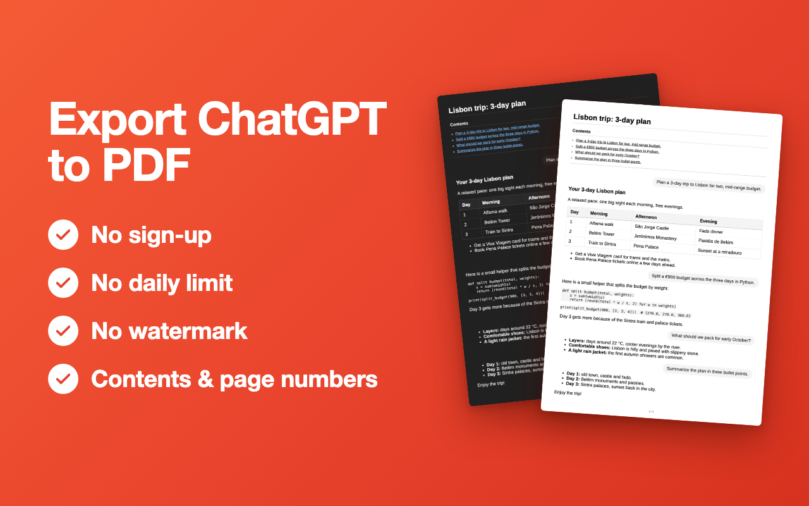
**Автор (04.10, следом):** «Отвратительный баннер — я просил тебя доработать тот, что у нас уже был — не нужно
выдумывать». Вариант выше отвергнут (лежит как история, в стор не идёт). **Урок: «баннер с фичами» при живом
баннере = доработка живого, не новый.**

## 2026-10-04 — Баннер CWS: доработка нынешнего (черновик, ждёт слова автора)
**Стало** (`dizajn/banner/2026-10-04-dorabotka/`): тот самый баннер, что в сторе
(`html_pdf_converter/banner/banner_large_simplified_1280_800.png` = `original.png`), не тронут; поверх — две
правки: (1) справа от «in one click» три белые плашки в стиле плашки «Export» — No sign-up · No daily limit ·
No watermark; (2) подпись листа PDF «Page 1 of 2 · Exported with Export ChatGPT Conversation» (фирменного
колонтитула у нас нет — спорил бы с «No watermark») → «1 / 2», как в настоящем PDF 1.1.11; шва нет (проверено
крупно). В стор — вместе с выходом 1.1.11.

## 2026-10-07 — Карточка экспорта: от клика до файла (1.1.12-dev · 07.10 14:45)
**Автор:** «если мы надолго бросим пользователя, например если там будет уже идти второй десяток секунд… человек
может начать сомневаться, а дойдёт ли скачивание до конца»; про плашку о вкладке — «это адекватное сообщение? или
излишнее?», и «давай дадим в ней какой-нибудь факт… про то, как работает дом ChatGPT»; тексты — «суше, короче,
законичнее, но суть — верная»; «собирай».
**Было:** карточка только на прокрутке («Loading conversation…» + «Please keep this tab open and in the
foreground»); после прокрутки — пусто, лишь счётчик секунд в кнопке Export, на длинном чате 30–70 с.
**Стало:** одна карточка до файла, три строки — что идёт сейчас · факт о ChatGPT · что можно делать.
Шаги: «Loading older messages… 23 parts» (+ «ChatGPT sends long chats in parts of about 10 messages.») →
«Reading 214 of 513 messages…» (с 5-й секунды + «ChatGPT draws only the messages on screen, so each one is
scrolled into view to be copied.») → «Adding images… 12 of 48» → «Compressing images… 5 of 30» → «Creating the PDF
from 513 messages… 0:23» (+ «You can switch tabs now — the file will download by itself.», с 20-й секунды
«Long chats take longer.»). На прокрутке подсказка — «Keep this tab visible: in a hidden tab ChatGPT stops
loading messages, and the export waits.» Обе подсказки о вкладке измерены в настоящем Chrome (CHATGPT-DOM §10,
07.10). Короткий экспорт карточку не мигает: без прокрутки она появляется, только если идёт дольше 3 с.
Число частей в факте A убрано — оно уже в строке над ним.
Кадры (светлая и тёмная): `kadry/2026-10-07-kartochka/` — pages · reading · paused · images · shrink · server · long.

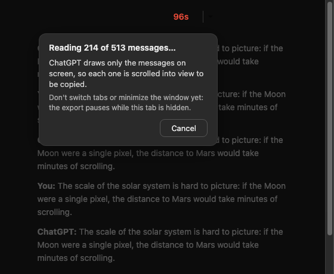
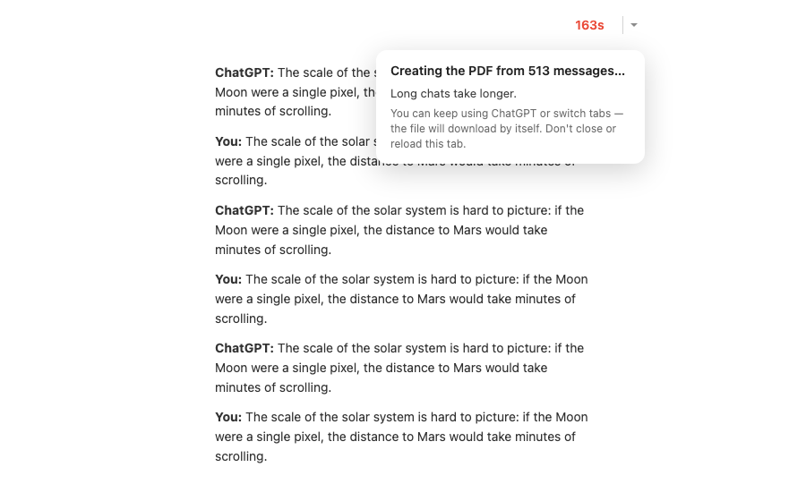
**Автор (07.10, следом):** «ChatGPT sends long chats in parts… — пусть это сообщение появляется не сразу, а например
через 10 секунд ожидания. Будет ощущение, что мы ведём диалог с юзером порционно, когда это нужно». → Оба факта
теперь приходят на 10-й секунде своего шага (правило одно: `GPTPDF_FACT_AFTER_MS`); стенд — сцена K.
**Автор (07.10):** «а нельзя ли ещё разблокировать экран чата, чтобы юзер мог что-то делать в ChatGPT — перейти в
другой чат, читать и скроллить текущий?» → С «Compressing images» затемнение снимается, карточка уходит в правый
нижний угол (без точек, с часами), страница кликается и крутится. Раньше нельзя: «Adding images» ещё читает живую
страницу. Подсказка: «You can keep using ChatGPT or switch tabs — the file will download by itself. Don't close or
reload this tab.» Проверено в настоящем Chrome: колесо мыши над чатом крутит ленту, переход на главную ChatGPT
внутри вкладки — файл приходит (39,6 с после прокрутки); перезагрузка вкладки — файл не приходит.

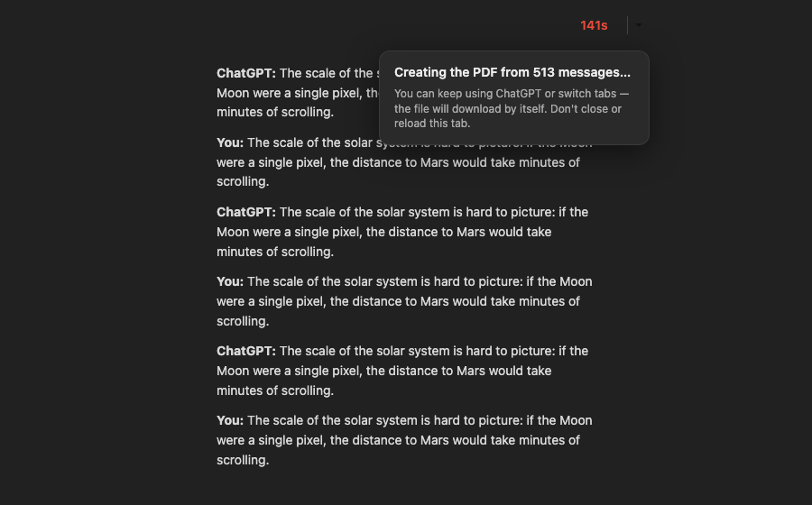
**Автор (07.10, о подсказке «Keep this tab visible…» с самого начала):** «тоже лишняя — мы заставляем с самого начала
читать какую-то информацию мелким шрифтом». → Заранее не говорим. Фраза появляется, только если вкладка правда была
скрыта дольше секунды, — после возвращения: «The export waited while this tab was hidden: ChatGPT loads messages
only in a visible tab.»
**Автор (07.10, скриншот):** «в двух разных местах счётчики, и с разными цифрами… выглядит плохо организовано. Цифра
пусть будет одна… может быть поместить её туда, наверх, тогда всё будет там наверху, где кнопка, — "приучаем" к
одному месту». → Число одно — время с клика, в самой кнопке (как и было: «96s»). Слова — панелью прямо под кнопкой,
там, где открывается её меню, на всех шагах. На чтении страница затемнена, кнопка и панель — поверх затемнения; с
«Compressing images» затемнения нет, панель на месте. Часы из панели убраны («Creating the PDF from 513 messages…»).
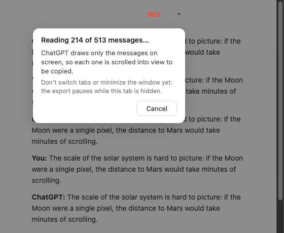

**Автор (07.10, 20:13, о факте «ChatGPT sends long chats in parts…» через несколько секунд после начала):** «это не
даёт мне как пользователю указания, что нельзя сворачивать или менять таб, — оно через 10 секунд после начала несло
бы пользу». → На 10-й секунде прокрутки — что делать: «Don't switch tabs or minimize the window yet: the export
pauses while this tab is hidden.» «yet» — потому что дальше, на «Creating the PDF», карточка сама скажет, что уже
можно. Факты сдвинуты на 30-ю секунду шага — один голос за раз. Кто ушёл до 10-й секунды и вернулся, видит
объяснение «The export waited…» — запоздалое предупреждение его не затирает (стенд, сцена L). Кадры `pages-*`,
`reading-*` перерисованы с этой строкой; новый `stay-*` — 12-я секунда.
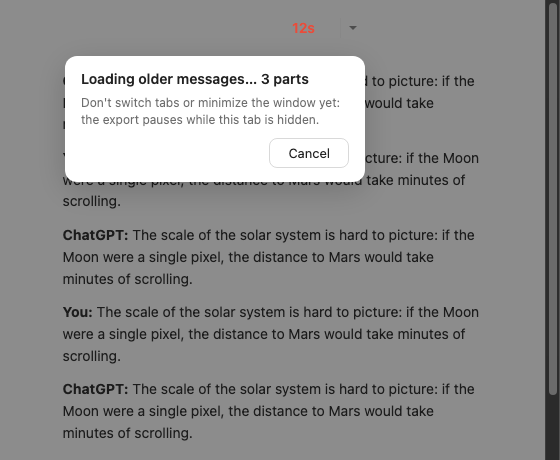
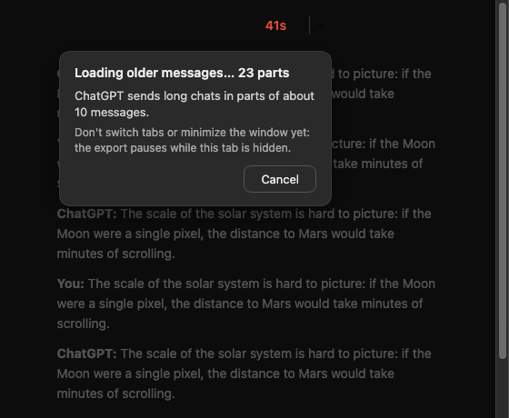
**Автор (07.10, 20:3x):** «появился вроде на 3-й секунде про 10 сообщений, но он не менялся, а где-то на 60-й исчез; у нас
же было 2–3 разных текста для разнообразия». → Было три факта, но каждый привязан к своему шагу; на его чате чтение
идёт ~10 с и свой факт (с 30-й секунды) не успевал. Слово автора «да, делай ротацию»: факты догрузки сменяют друг
друга каждые 20 с с 30-й секунды — «ChatGPT sends long chats in parts of about 10 messages.» ↔ «Each part is a
separate request to ChatGPT's server and takes a few seconds.» (замер §10: ~4–5 с на часть, ждём сервер); факт чтения
— с 10-й секунды чтения. Стенд: сцена K (30 → 50 → 70 с; чтение +10 с) ✅. Кадр `request-*` — 58-я секунда.
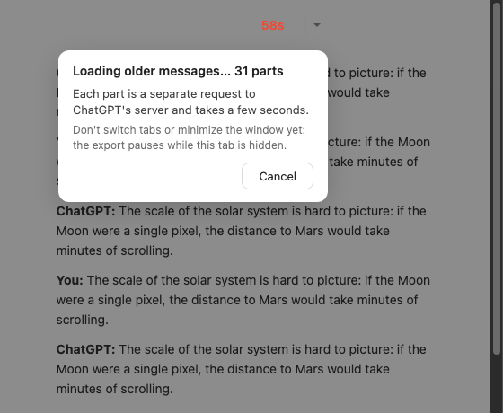

## 2026-10-08 — Третий скриншот CWS: «Every format makes it to the PDF» (черновик, ждёт слова автора)
**Автор:** «давай ещё сделаем один баннер к нашим двум — третий, в котором укажем наши преимущества: что форматирование
передаётся — все форматы, вот может это наше решение с двумя ссылками показать»; следом — «может быть даже сделать слайд
с набором деталей, чтобы было видно, с какими кейсами и форматами справляется — ссылки, графики, код…»; из двух — «1»
(шесть плиток 3×2). По дороге найдено: формулы в PDF печатались «x2» — автор: «2, потом 1» (сперва починка формул,
1.2.2, потом баннер), поэтому плитка Formulas — правда только с 1.2.2: баннер в стор вместе с ней.
**Стало** (`dizajn/banner/2026-10-08-formaty/`): стиль двух нынешних (градиент, белый заголовок снизу слева); шесть
белых плиток — Tables · Code · Formulas · Charts · Images · Sources, each a link; заголовок «Every format makes it to the
PDF», строка «Long chats in full · Clickable contents». Каждая плитка — вырезка из НАСТОЯЩЕГО PDF через наш сервер:
таблица, код, формулы, картинка — демо-чат стенда (`blockmode-live-stand.html?demo=formats` → `e2e-render.js`; картинка —
пиксель-арт автора из «Художника»), график и «matplotlib.org · NumPy» — тестовый чат автора в светлой теме. Таблица
обрезана до двух столбцов (во всю ширину листа в плитке не читалась).
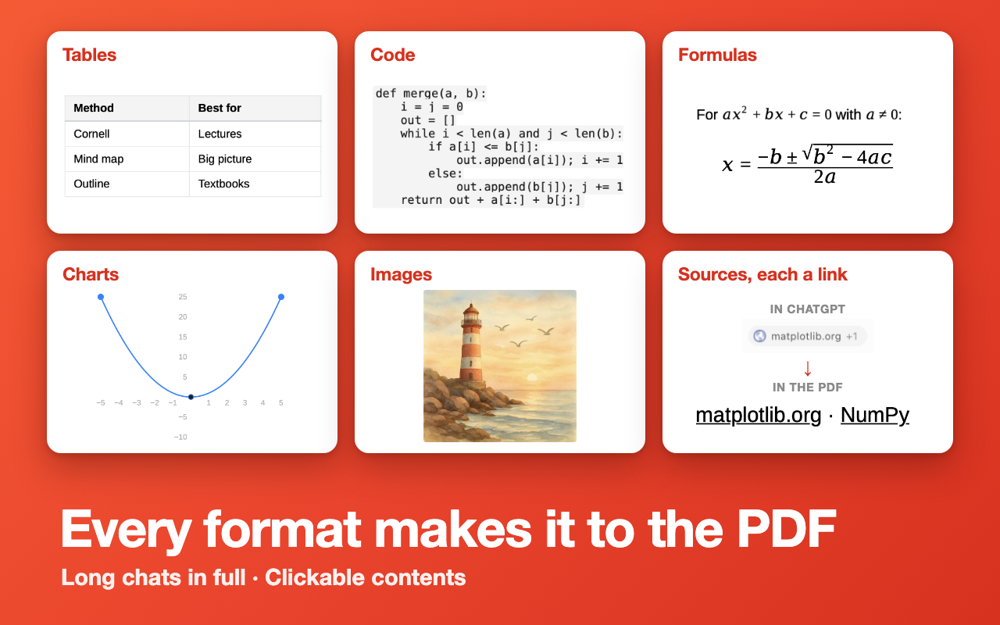
**Автор (08.10, следом):** «по картинке — возьми что-то нейтральное; formulas — да, я буду подавать баннеры одновременно с
1.2.2; плитка источников — да, покажи на фоне того, как это выглядит в чате». → Картинка — акварельный маяк (gpt-image-1),
выгружен тем же конвейером. Плитка источников: «IN CHATGPT» — снимок настоящей плашки «matplotlib.org +1» со страницы
шаринга, стрелка, «IN THE PDF» — «matplotlib.org · NumPy» из PDF. Ставится в стор вместе с 1.2.2.

## 2026-11-16 — Ревью вида PDF и настроек (повод — оценка 1★ за вид)

**Слово автора:** «вернуться к вёрстке и дизайну наших страниц и настроек… нигде нет выбора шрифта… неплохо настройки
мы проработали в Fill in the Blank… тема с пресетами, а уже под пресетом индивидуальные настройки».
**Найдено** (`dizajn/obzor-2026-11-16/README.md`):
- шрифт у всех — случайная копия Arial (Liberation Sans): системных шрифтов из стилей на сервере нет;
- поля ≈10 мм, строка ≈100 знаков;
- вопрос не держится за свой ответ;
- тёмный ChatGPT по умолчанию даёт чёрный PDF;
- на сервере уже есть Noto Sans, Noto Serif и Carlito — выбор шрифта можно дать без работ на сервере.

Набросок: шаг 1 — основа (её увидят все), шаг 2 — три стиля-плитки, как в FIB. Ждёт решения автора.
Кадры: `obzor-2026-11-16/kadry/` — `sejchas-demo-plan.png` · `sejchas-demo-formaty.png` · `sejchas-temnyj-chatgpt.png` ·
`shrifty-sravnenie.png` · `nastrojki-sejchas.png` · `server-alfavity.png`.

## 2026-11-16 (вечер) — основа принята; макет окна настроек v1

**Автор (после кадров основы):** «Тёмный лист может быть полезен только если человек читает с устройства… я бы оставил
эту настройку… Сейчас выглядит красиво, мне нравится, чистенько, хорошо. Но меня интересует, сделай макет страницы
настроек. Как ты это видишь?» · Следом: «Цена в страницах считаю приемлемым. Пусть дефолтный пресет будет красивым и
хорошим».
**Сделали:** макет v1 `obzor-2026-11-16/maket/nastrojki.html`:
- миниатюра листа в меню Export вместо строки «Settings ›»;
- окно: лист слева, закладки Style · Paper · Header справа;
- три стиля-плитки Chat · Document · Compact, ручки под ними, метка «Custom · ↺».
Подробно и таблица «что куда переехало» — README §8 ревью. Пройден настоящими щелчками в Chrome.
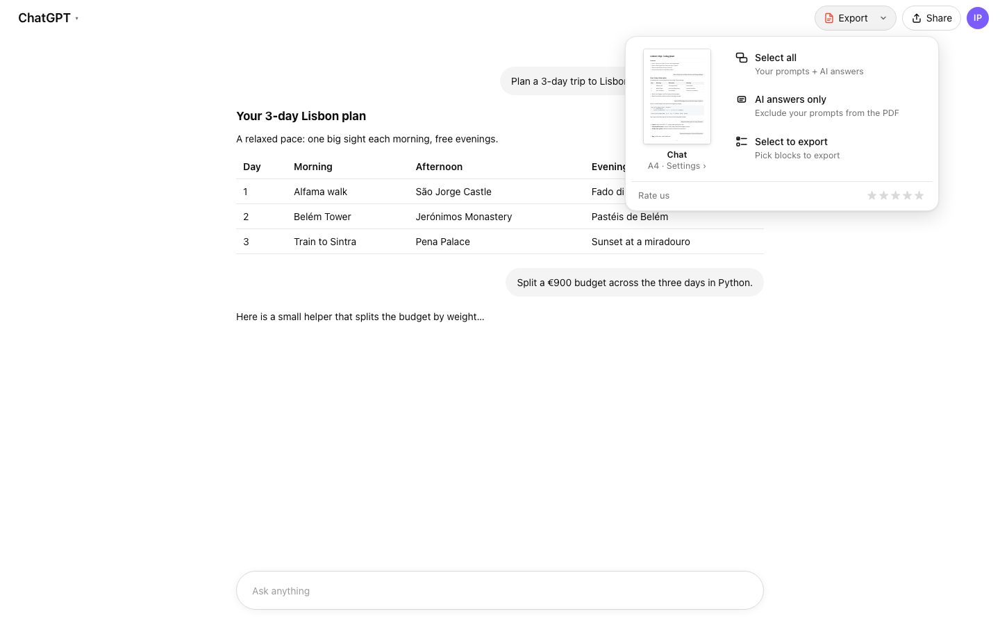

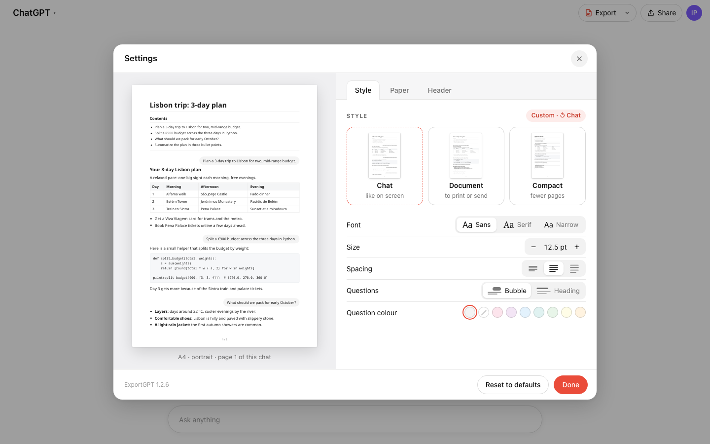
**Автор о макете v1 (16.11):** «Слушай, ну просто круто сделано. Вот мне сейчас очень нравится, очень понятно было,
доходчиво. Наконец-то я вижу хорошо сделанные настройки». Направление окна принято.
**Автор, следом:** «Раньше была просто видна миниатюра, хрен поймёшь, что вообще где. А сейчас мы берём за образец реальную
страницу, первую страницу чата, правильно? Шикарно». В окне до 1.2.6 превью — серые полоски-схема (`kadry/nastrojki-sejchas.png`);
в макете — настоящая первая страница в выбранном стиле.

## 2026-11-16 — 1.2.6-dev: основа в коде

**Автор:** «Давай только в две разные версии. Значит, первую сейчас уже сделай dev… я буду тестировать. А уже следующая
версия… может быть, с другими функциями, а может быть и не будет. Это мы выясняем сейчас через замер».
**Сделали:** основа из наброска перенесена в код: шрифт и ритм (`render.js`, `buildExportCss`), поля 18/20 мм
(`background.js`), лист светлый, пока не выбран Dark (Auto убран из окна настроек). Кадры сняты через настоящий
сервер и совпадают с наброском.
- `1-2-6-dev-plan.png` — Lisbon trip, настройки по умолчанию;
- `1-2-6-dev-formaty.png` — Study notes: таблица, код, формула;
- `1-2-6-dev-temnyj-chatgpt.png` — ChatGPT в тёмной теме, лист светлый;
- `1-2-6-dev-temnyj-list.png` — выбран Dark.

**Найдено по ходу:** перестройка блока кода (`createCodeBlock`) в экспорте не срабатывает: копия чата не вставлена в
документ (`isConnected`). Вид кода в PDF задают стили. Настоящий блок кода ChatGPT на стенде не виден — его увидит
живой тест автора.

## 2026-11-16 (вечер) — 1.2.6-dev: новое окно настроек в коде

**Автор, после первого дева:** «у меня точно такой же экран… те же самые окно настроек» → «Да, именно так. Первая версия —
основа вместе с окном, вторая — новые выгрузки, если их поддержит замер».
**Сделали:** окно по макету v1 — уже в расширении:
- миниатюра первой страницы в меню Export вместо строки Settings;
- окно: настоящая первая страница чата слева (`preview.js`, те же стили, что уходят на сервер), справа Style · Paper · Header;
- стили Chat · Document · Compact, ручки, «Custom · ↺»;
- в Paper — поля Narrow (10 мм) и «One long page» как вид разрыва страниц.
Проверено настоящими щелчками на живом стенде (Chrome), PDF стилей Document и Compact — через настоящий сервер.
- `1-2-6-dev-okno-menyu.png` · `1-2-6-dev-okno-stil.png` · `1-2-6-dev-okno-bumaga.png` · `1-2-6-dev-okno-shapka.png` ·
  `1-2-6-dev-okno-temnyj-chatgpt.png`;
- `1-2-6-dev-pdf-document.png` · `1-2-6-dev-pdf-compact.png` (демо на одной странице).
⬜ Шрифты листа в расширении — ждут слова автора на скачивание; до них лист в окне рисуется запасными шрифтами
страницы, PDF это не затрагивает.
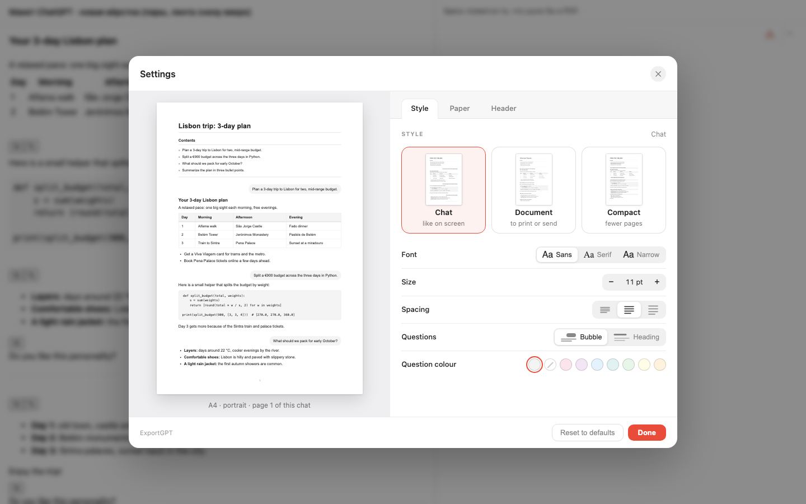

## 2026-11-16 (вечер) — живой чат автора: что ломалось и почему

**Автор:** «в превью… только заголовок… содержание и всё»; «после таблицы… около десятка строк пропущено»; «этот дурацкий
+1… чтобы они были кликабельными. И раздельными. Если это невозможно… убрать к чертовой матери»; «цвета… иначе мы
убиваем родное форматирование… задача не убить родное форматирование, с другой стороны, сделать его под документ».
**Найдено по дампу его чата:** ответы ChatGPT теперь собраны новыми блоками (`data-d-component`) со своими цветами через
переменные ChatGPT; таблица несёт невидимую полосу «краёв» 1732×292 px; источники «+1» — значок без адреса.
**Сделали:** блоки печатаются как на экране (карточки файлов — рамка, зелёная иконка, серая плашка; значки — цветные),
дыры после таблиц ушли, «+1» убраны, длинный вопрос рвётся по страницам. Кадры — только у автора: в них его чат.

## 2026-11-17 — выбор блоков: синий вместо красного, своя галочка; анимация чтения — вариант A

**Автор:** «рамочки красные… красная — это когда мы что-то удаляем… давай придумаем более нейтральный цвет. Может, зеленый
или синий, голубой»; «в чекбоксе, если мы чекаем, давай галочку там оставим… ты выбрал, а галочка не появляется. Тогда зачем
чекбокс?»; «весь текст сплошняком он распознаёт как image блок… я могу только выбрать весь ответ».
**Сделали:** синий — цвет «выбрано» (рамка, заливка, чекбокс, «Select all», «Select image block»), только в режиме выбора;
фирменный красный остался на кнопках. Чекбокс рисуется целиком расширением (рамка, заливка, белая галочка) — стили страницы
его не перекрашивают. Новый ответ ChatGPT снова делится на абзацы, списки и таблицы (был одним блоком, «картиночным» из-за
значков источников); «картиночный» блок — только с настоящей картинкой.
Было (красный) · стало (светлая тема, «Select all») · стало (тёмная):
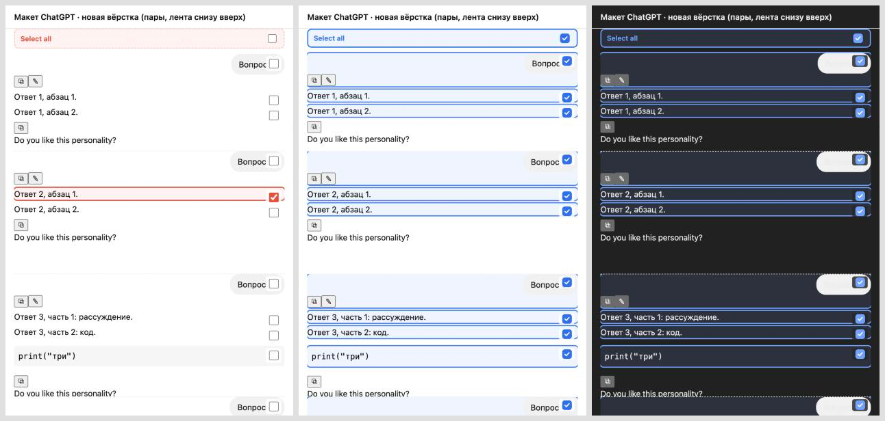

**Анимация шага чтения.** Два наброска: A — человечек крутит ручку, лента сообщений едет сквозь «экран», копии летят в стопку;
B — фонарик, сообщения видны только в его свете. Автор выбрал A: «вариант А… только сделай человечка… рука не движется…
колесико крутится, а рука как будто стоит. Ну, вот этот момент, он некрасивый. Сделай еще один макет». v2: рука из двух
звеньев держит ручку и ходит с ней по кругу, корпус подаётся вперёд-назад; пауза честная — вкладку спрятали, человечек
отпускает ручку и ждёт. Макет — [`animaciya/maket-a-v2.html`](animaciya/maket-a-v2.html) (`?dark` — тёмная тема).

## 2026-11-17 — человечек в карточке: встроен (1.2.6)

**Автор** о макете v2: «Человечек да так, встраивай».
**Как устроен:** под строкой шага, цветом текста карточки (светлая и тёмная сами). Идёт за настоящим счётом, не за часами:
подъём к началу — ручка крутится назад, листы не летят; чтение — каждое новое число шлёт лист в стопку; 2,5 с без нового
— отпускает ручку, поворачивается к читателю, «…»; вкладка скрыта («Paused») — ждёт; картинки и PDF — сцены нет. Короткий
чат не мелькает: сцена с 1,2 с. «Уменьшить движение» в системе — неподвижный кадр.
Подъём · чтение (лист летит) · 4 с без нового (ждёт) · картинки (сцены нет); сверху светлая, снизу тёмная:

## 2026-11-17 (день) — человечек v3: крутит вверх, читает вниз, ждёт картинки

**Автор** после живой выгрузки «Художника»: «долго ничего не менялось в анимации на reading 58… секунд 30–40»; «может быть,
он вверх крутит, а вниз он просто читает, а крутится само». **Почему стояло:** спуск ждёт картинки каждого показанного
сообщения (до 5 с на шаг), а строка «Reading N» обновлялась раз в 8 шагов — число стояло, человечек «ждал», хотя работа шла.
**v3:** подъём — крутит ручку (ChatGPT нужно заставить отдать старое); чтение — лента шагает сама, он кивает каждому
сообщению и пишет в блокнот, листок уходит в стопку; ждём картинки — в окне проявляется картинка, строка это говорит;
вкладка скрыта — «…». Макет — [`animaciya/maket-a-v3.html`](animaciya/maket-a-v3.html) (`?p=climb|read|pics|pause`).

**Встроен v3** (слово автора «Да, давай встраивай»): подъём · чтение (блокнот, листок в стопку) · ждём картинки (строка
«— waiting for pictures…») · ждёт «…» · картинки (сцены нет); сверху светлая, снизу тёмная:
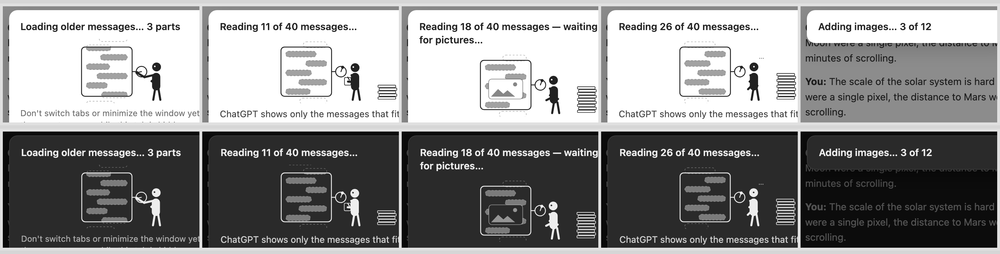

## 2026-11-17 (вечер) — человечек: два состояния

**Автор** после живой выгрузки «Художника» на v3: «ридинг… он начинает как бы крутить, потом у него waiting for pictures,
он бросает… это скорее больше раздражало… Я предлагаю 2 состояния наверх и вниз… waiting for pictures не надо… но чтобы
не было такого, как я сейчас описал».
**Сделали:** наверх — крутит; вниз — пишет в блокнот (и пишет дальше, пока грузятся картинки); вкладка скрыта — замирает.
Ни поз, что меняются сами, ни строки про картинки. Счёт «Reading N» по-прежнему растёт с каждым сообщением.
Наверх · вниз · вниз, число стоит (картинки) · картинки (сцены нет); светлая и тёмная:
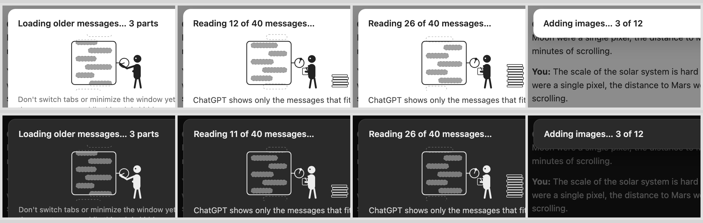

## 2026-11-17 (вечер) — 1.2.7-dev: герой остаётся до файла

**Автор** после прода 1.2.6: «когда файл на сервере, это тоже довольно много времени, и там… пропадает наш герой и оставляет
нас. Нехорошо». **Сделали:** после прокрутки (подготовка, картинки, сервер) он идёт к своей стопке и скрепляет её степлером
в книгу — обложка закрывается, на ней «PDF»; стучит, пока не придёт файл. Стопка — та, что он набрал при чтении; между
шагами сцена не мигает. Чтение · картинки (пошёл к стопке) · картинки (обложка закрывается) · сервер (книга «PDF»):
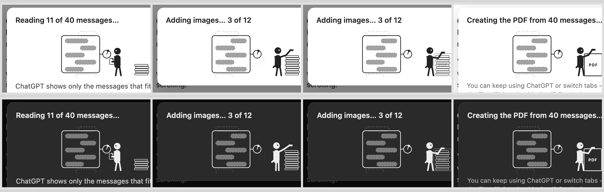

## 2026-11-17 (вечер) — 1.2.8: милый персонаж, макет

**Автор** после прода 1.2.7: «давай-ка возьмем версию 1.28 dev и попробуем сделать… анимацию более привлекательной, при этом
не утяжеляя… дать ему немножко характера, сделать из него милого персонажа».
**Макет:**
- Пропорции малыша: большая голова, короткое тело, круглые ладошки и ботинки.
- Руки гибкие, без локтей, провисают, когда свободны (у такого тела прямые руки с локтем выходили длиннее туловища).
- Лицо своё на каждом шаге и держится весь шаг:
  - наверху пыхтит («о»);
  - внизу высунул язык и пишет;
  - у книги улыбается во весь рот.
- Между шагами только мелкая жизнь: моргает, дышит, хохолок качается, когда он двигается.
- Пока идёт к стопке, держит степлер у груди; дошёл — тянется к книге.

Два вида:
- **А** — с лицом: волосы, розовые щёки и язык; в тёмной карточке лицо остаётся светлым.
- **Б** — силуэт: белые глаза на чёрной голове, без цвета.

Вес: +6 КБ кода, в архиве ≈ +2 КБ из 859.
Макет — [`animaciya/maket-b.html`](animaciya/maket-b.html), один файл, открывается из Finder (собирает `maket-b/sobrat.py`;
крупный кадр — `maket-b/krupno.html` + `kadr.sh`). Строки 1.2.7 · А · Б, столбцы наверх · вниз · книга; светлая и тёмная:
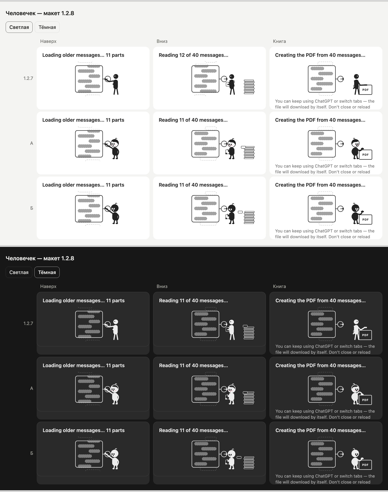
Вариант А крупно, светлая и тёмная:
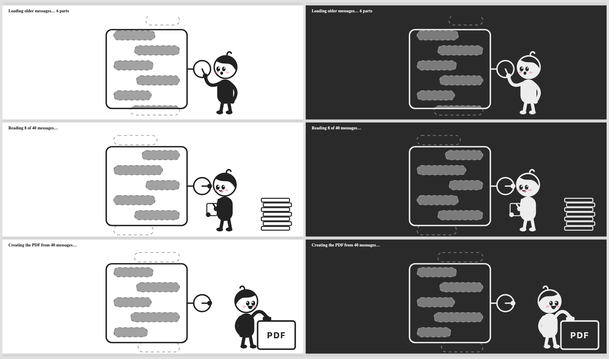

## 2026-11-17 (вечер) — 1.2.8: клерк из прошлого, макет

**Автор** о милом макете: «Мне не нравится его радостное, ликующее лицо. Давай он будет более сдержанным… По сути, что он
делает? …офисным сотрудником из прошлого. Почему из прошлого, не знаю. Таким элегантным».
**Макет:**
- Взрослые пропорции: голова меньше, тёмный костюм, белый воротничок и бабочка, круглые очки.
- Белые перчатки на гибких руках — руки 1930-х, их видно и на тёмном костюме.
- Лицо спокойное и держится весь шаг:
  - у ручки — ровная линия рта;
  - над блокнотом — внимательное;
  - над книгой — сдержанная улыбка.
- Ушли язык, открытый рот, щёки и хохолок. Остались мигание, дыхание, кивок каждому сообщению.
- Шаги к стопке короче и ровнее.

Два вида: **в котелке** и **без шляпы** — гладко зачёсан. В тёмной карточке он светлый силуэт с тёмными очками и
бабочкой; лицо и перчатки обведены тёмным.
Вес: +6 КБ кода, в архиве ≈ +2 КБ.
Макет — [`animaciya/maket-c.html`](animaciya/maket-c.html) (собирает `maket-c/sobrat.py`). Строки 1.2.7 · котелок · без
шляпы; светлая и тёмная:
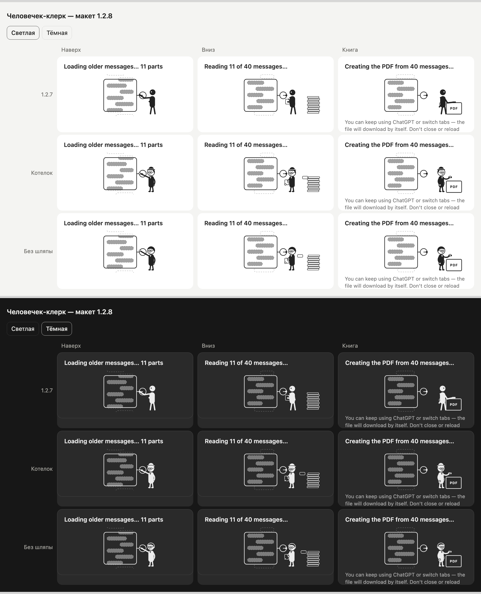
В котелке крупно:
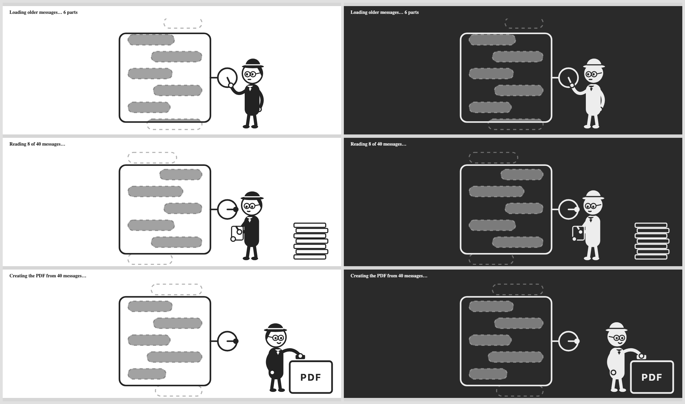

## 2026-11-17 (вечер) — 1.2.8-dev: клерк в котелке встроен

**Автор:** «Да, в шляпе, только сделай его самого более узким. Он сейчас такой кругленький, а сделай его более тонким,
более таким худым. И да, можно встраивать».
**Сделали:**
- узкий пиджак, вытянутая голова, тонкие руки и ноги; ноги длиннее;
- к книге подходит ближе;
- вариант без шляпы из кода убран.

В карточке: подъём · чтение · картинки (скрепляет) · сервер (книга «PDF»); светлая и тёмная:
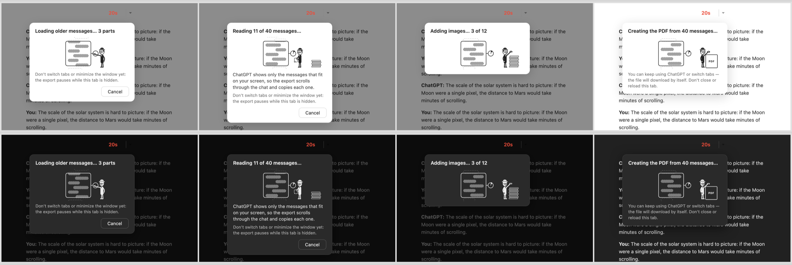

## 2026-11-17 (ночь) — 1.2.9: форматы Word и Markdown в меню, макет

**Автор:** «Это наши новые форматы… Ворды, маркдауны. Где бы это добавить? В основном меню или уже в сеттингах?…
Желательно, чтобы была прям пиктограмма Word, PDF, чтобы это сразу считывалось… AI answers only… можно засунуть в settings.
…Select to export. Это прям отдельный инструмент, его надо оставить… нужно ли столько текста… В общем, сделай несколько
вариантов». Версию выбрать Клоду: форматы — **1.2.9**, клерк 1.2.8 уходит отдельно.
**Макет** — [`formaty/maket-formaty.html`](formaty/maket-formaty.html), замысел и разбор — [`formaty/README.md`](formaty/README.md).
Во всех вариантах:
- «Select all» ушла, это и так делает Export;
- «AI answers only» стала третьим положением Questions: Bubble · Heading · Hidden.

Варианты:
- **A** — плитки PDF · Word · Markdown выбирают файл, значок на кнопке его показывает;
- **B** — каждая строка сразу скачивает свой файл;
- **C** — три листа-картинки;
- **D** — формат в окне настроек.

Сверху: сейчас · A · B. Снизу: C · D · A с Markdown.
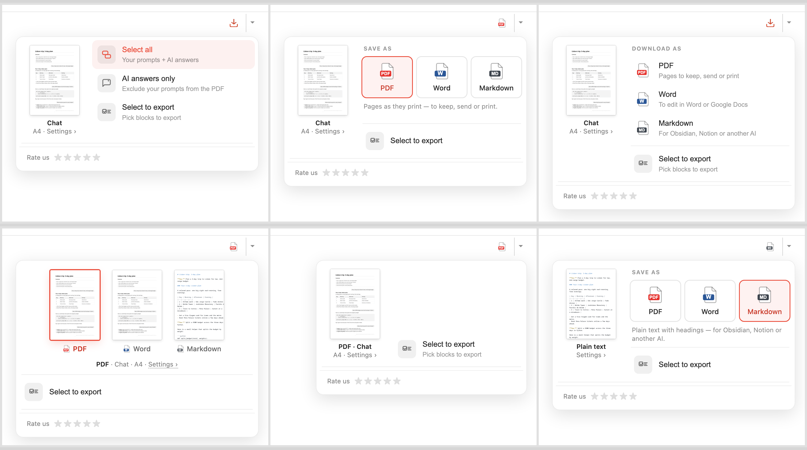
Окно настроек: Questions · Hidden — лист без вопросов, цвет вопроса погас:
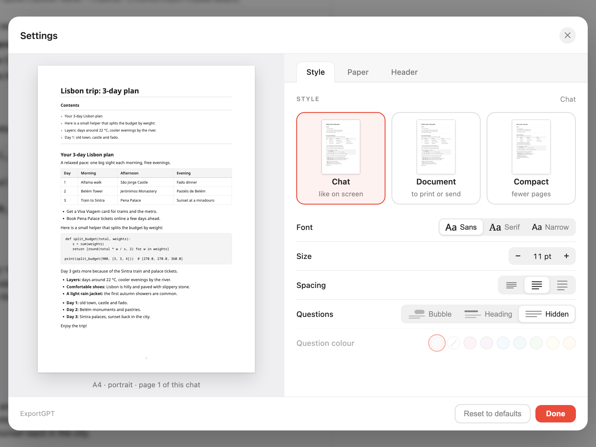
При Markdown шрифты и бумага приглушены, лист — текст:
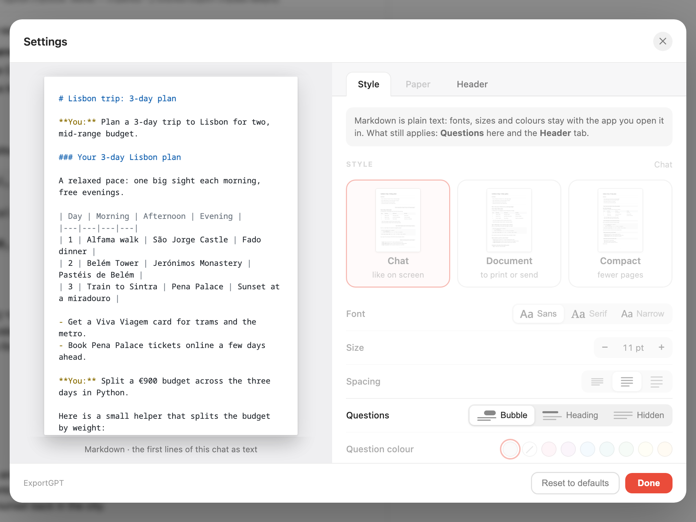

## 2026-11-18 (ночь) — 1.2.9-dev: вариант A в коде, Word и Markdown выгружаются

**Автор:** «Вариант А, только, думаю, неправильно… менять миниатюру. Она остаётся той, которая была. Миниатюра кнопки.
Кнопки экспорта… В целом мне нравится, да, так гораздо лучше, чем было». И о Markdown: «насколько сейчас у нас feasible
сделать экспорт в Word корректный… и в Markdown… может быть, на месте маркдауна сделать загрузку в разные источники…
маркдаун — это всё-таки технический момент… Но тот вариант, который есть, сейчас тоже может быть». «Давай 1.2.9 Dev».

Сделано:
- значок кнопки Export прежний при любом файле; выбранный файл — красная плитка и подсказка у кнопки;
- «Select to export» одной строкой, пояснение — при наведении;
- одна линия над «Rate us» (было две);
- лист в меню при Markdown — первые строки самого файла этого чата, подпись «Plain text».

Меню в дев-сборке: PDF · Word · Markdown, значок на кнопке тот же:
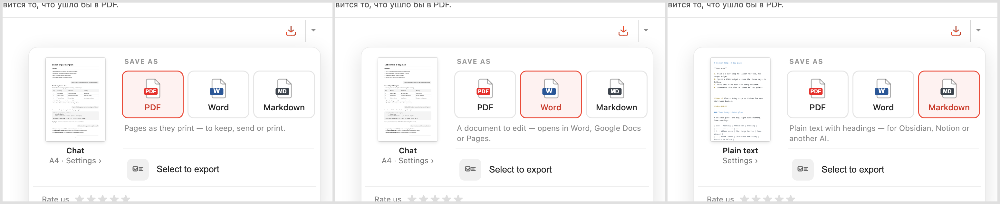
Окно при Markdown — лист показывает начало .md-файла, приглушено то, чего у текста нет:
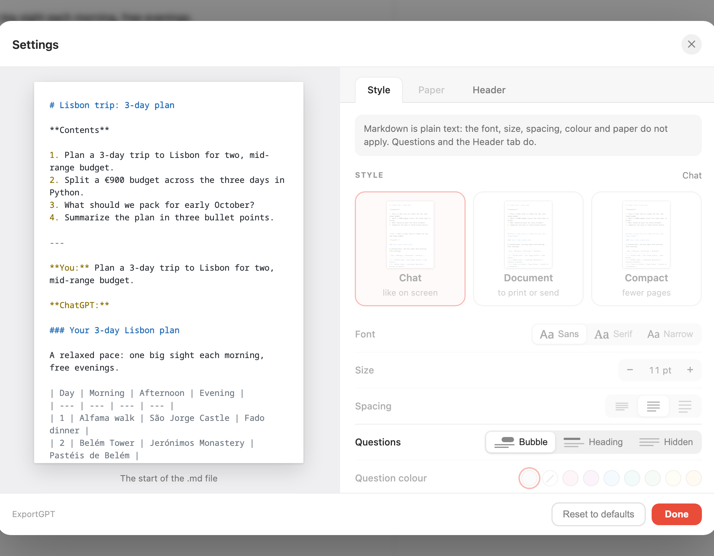
Questions › Hidden (бывшая «AI answers only»):
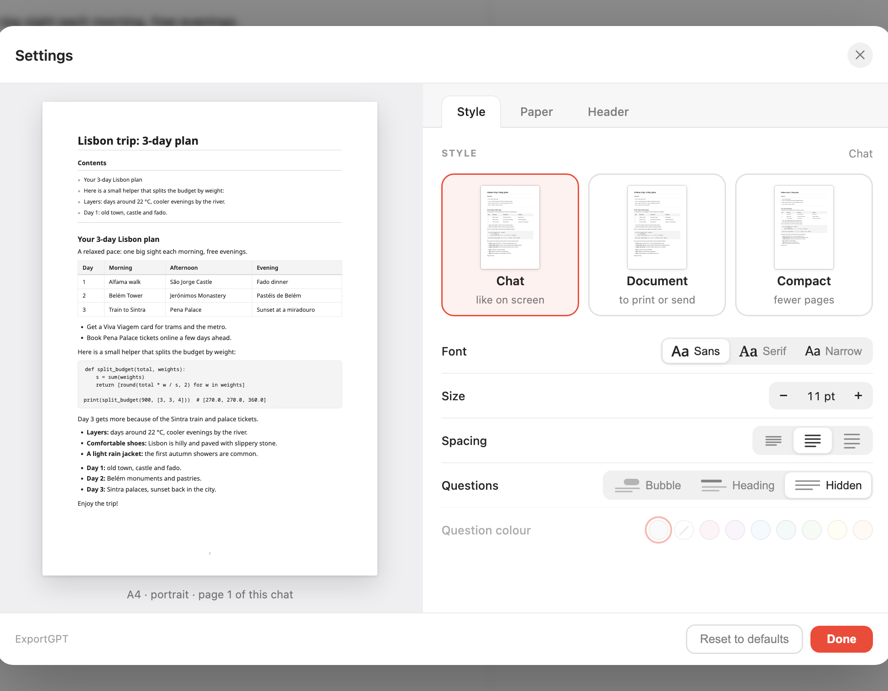
Word, закладка Paper: тёмного листа и «одной длинной страницы» у Word нет:
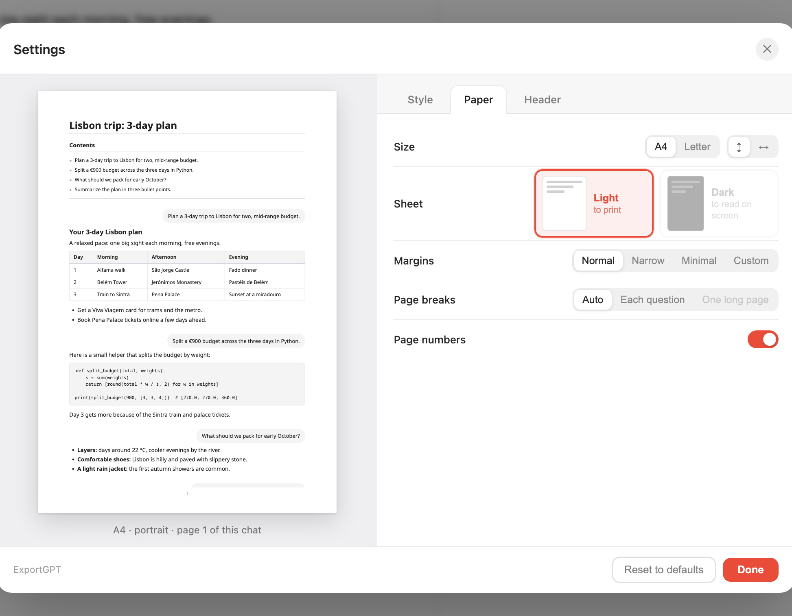

**Предложение на выбор автору — четвёртая плитка «Claude»** (кадр поверх стенда, в коде её нет): меню «Export to:
PDF · Word · Markdown · Claude»; Claude копирует чат и открывает Claude, вставить — ⌘V. Почему Claude по имени: из новых
целей у него самый большой спрос (≈3 300 в месяц в США), Obsidian ≈40 и Notion ≈100 — их закрывает файл Markdown.
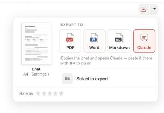

## 2026-11-18 (день) — «Select to export» читается как призыв; сцена экспорта как театр

**Автор, после живой выгрузки «Художника» и «мудреца» в Markdown и Word:** «Первое, прям критическая ошибка, кнопка Select
to Export теперь выглядит как призыв, что сюда нужно нажать, чтобы экспортировать. Это совершенно ложная ассоциация».

Почему так вышло: в 1.2.8 строка стояла третьей среди выборов «что берём» (Everything · AI answers only · Select to export);
в 1.2.9 соседи ушли, и одинокая строка под плитками стала читаться как следующий шаг — «теперь нажми сюда».
Два предложения (накладываются только в стенде, `?menuvar=a|b`; код расширения ждёт слова автора):
- **A** — второй выбор под форматами: What goes in · [Whole chat] [Pick blocks…], целиком уже выбрано — жать нечего;
- **B** — тихая строка-ссылка: «Only some parts? Pick blocks ›».

Сейчас · A · B:
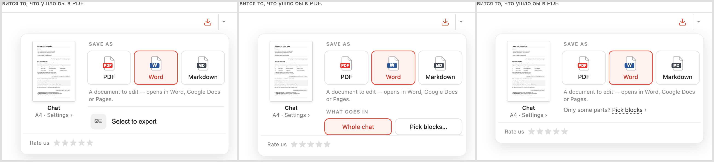

**Сцена.** Автор: «затемняя экран, мы как бы делаем спотлайт… на этом окошке, где можем изображать сценку… Первично
сценка… объяснение… пусть будет аннотацией… это бабл от человечка, это он говорит… Don't switch tabs… на стене… слева
от проектора… серьёзное предупреждение, не то чтобы прям красным, но в принципе красным… сцену… чуть-чуть тёплой… очень
тонкий намёк на то, что это как бы свет от проектора… Не нужно тут художественности никакой, минималистично».

Макет (`dizajn/scena/maket.html`, клерк — настоящий `anim.js`): карточка шире (440 вместо 300) и сцена крупнее; над сценой —
воздух, в нём реплика клерка от первого лица; табличка на стене слева от экрана — красный заголовок, тонкая рамка, текст
серый; после прокрутки, когда страница снова твоя, табличка та же, спокойная: «You can switch tabs». Зал — мягкое
затемнение, светлее у сцены; жёсткий круг луча пробовали — слишком «театр», убрали.

Наверх · вниз · книга:
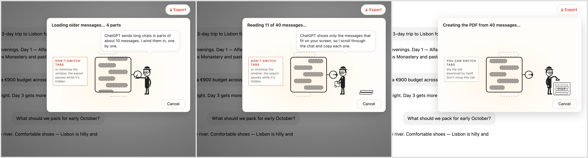
Тёмная тема:
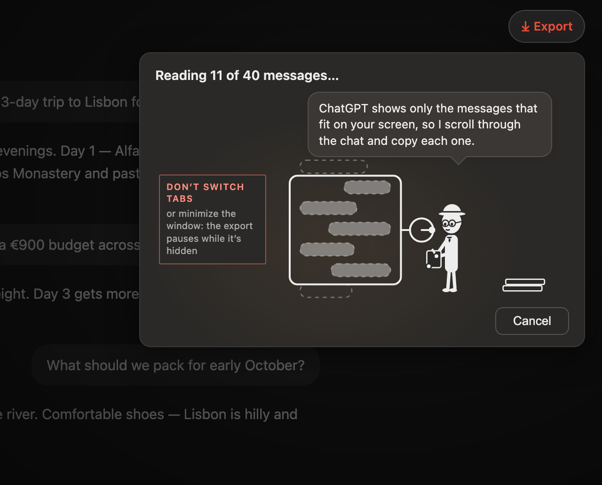

## 2026-11-18 (вечер) — слово автора: A, сцена, Markdown без ожидания картинок — в продукте

**Автор:** «Вариант А, да. Согласен. Вариант А вполне себе понятен. Второе, сцена, театр. Да, отлично, мне нравится.
Markdown, третье, чиним, давай».

Сделано в 1.2.9-dev:
- меню: Save as · **What goes in** — [Whole chat] [Pick blocks…]; «Whole chat» выбран, пока блоки не выбираются; во время
  выбора горит «Pick blocks…», «Whole chat» из него выводит (как ✕). Стрелка меню во время выбора теперь открывает меню —
  раньше она, сидя внутри кнопки Export, заканчивала выбор, а с отмеченными блоками сразу их выгружала;
- карточка — сцена по макету: шире (440), над сценой воздух под реплику клерка (факты — от первого лица), табличка на стене
  слева от экрана (предупреждение с 10-й секунды, как было); после прокрутки та же табличка спокойная — «You can switch
  tabs»; зал темнее вдали от карточки; сцена чуть тёплая. Без человечка (короткий экспорт) — те же две строки, как раньше.

Меню в продукте (светлое · тёмное):
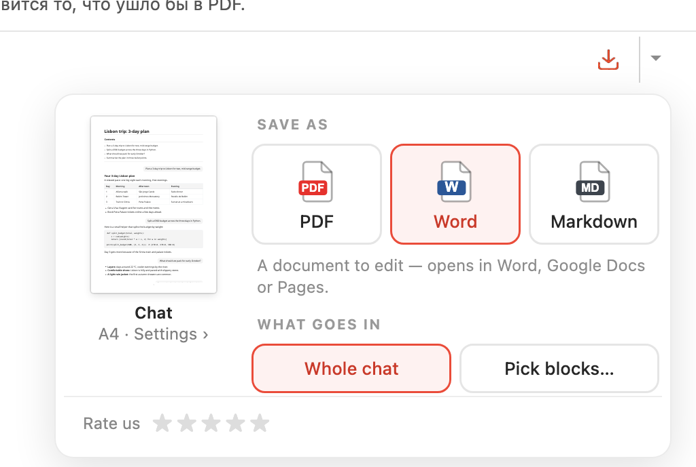
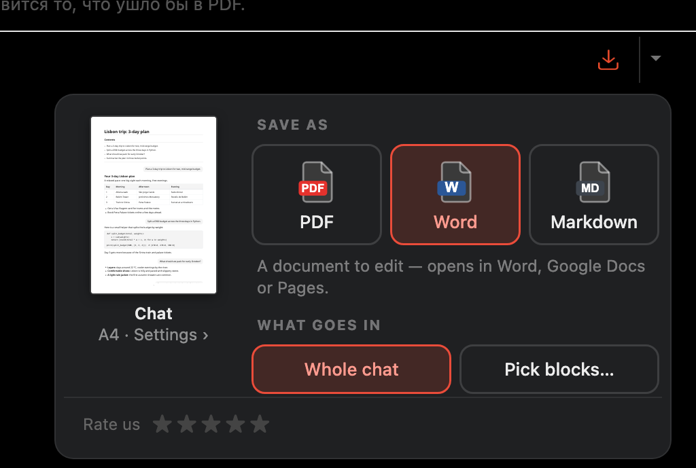
Сцена в продукте — настоящая карточка (стенд `progress-card-stand.html?step=walk&manual`): наверх · вниз · книга:
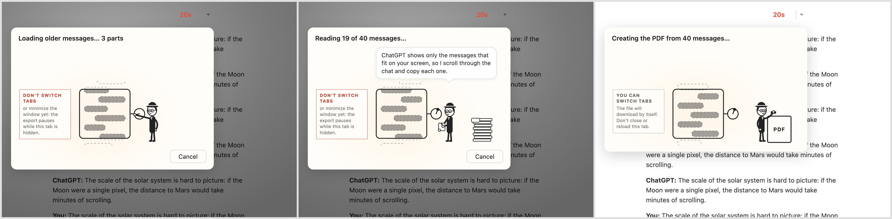
Тёмная тема:
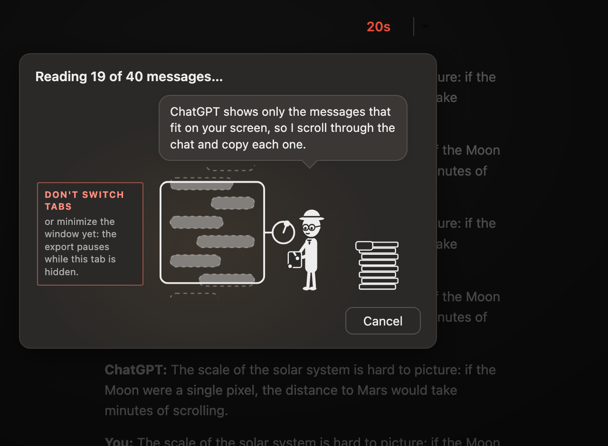

## 2026-11-18 (вечер) — 1.2.10-dev: плитка Claude

**Автор:** «Да, давай сделаем так, чтобы наш спрос… на Claude… удовлетворялся… придумай, как это сделать, куда, в Claude, в какой
Claude, в приложение, в аппу или как-то ещё. Ладно, давай, я согласен, пусть это будет 1.2.10».

Как сделано (по макету `predlozhenie-claude.png`, который автор видел): меню «Export to · PDF · Word · Markdown · Claude»; у Claude
значок — лист с пузырём реплики (не чужой логотип); лист в меню — начало текста для Claude, подпись «Text for Claude». Экспорт
идёт как Markdown (без ожидания картинок), а в конце карточка ждёт щелчка: «Ready for Claude: N messages», клерк говорит, что
будет, и как вставить (⌘V), кнопки **Close** и **Copy and open Claude**. Щелчок кладёт текст в буфер и открывает claude.ai/new
в новой вкладке; буфер общий — можно вставить и в приложение Claude.

Меню и карточка:
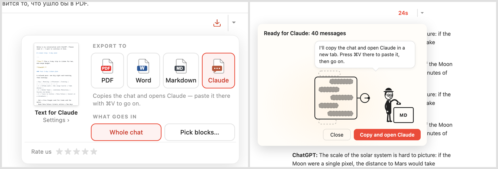
Тёмная тема:
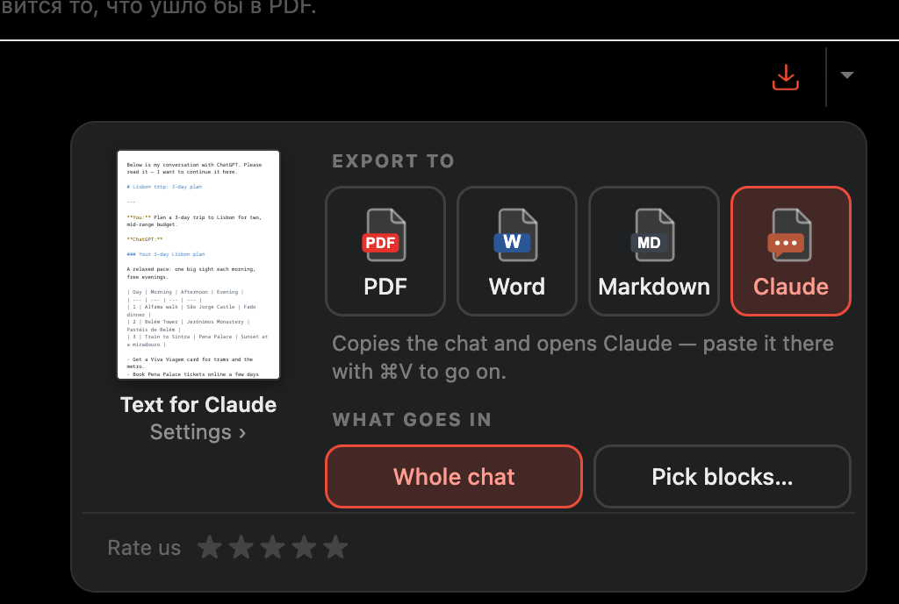
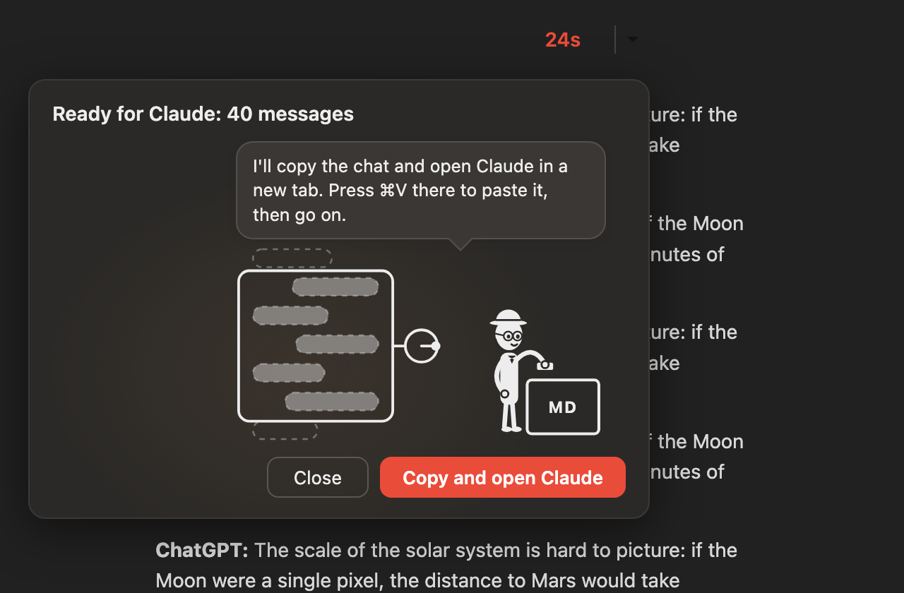

## 2026-11-18 (вечер) — предложение: плитки с выбором внутри — Word ▾ и Claude ▾

**Автор:** «на месте Markdown… видеть там Claude, потому что это самый популярный запрос… со своим внутренним селектором…
справа сегментик… Claude, Obsidian, Notion… тут как будто какой-то обман, потому что на самом деле это просто Markdown, но мы же
ещё и открываем сайт… пиктограммка будет тоже меняться… И ещё вопрос в Google Docs… опцией второй кнопки, где сейчас Word…
выбор между Word и Slides… А может, вообще не нужно».

Предложение (накладка в стенде `?menuvar=split[&open=dest|word]`, продукт не тронут): три плитки — PDF · **Word ▾** · **Claude ▾**;
сегмент справа открывает список, плитка помнит выбор и показывает его имя и значок. Обмана нет — у каждого пункта своё
действие: Claude — буфер + claude.ai; **Obsidian — заметка появляется сама** (`obsidian://new…&clipboard`); Notion — буфер +
новая страница (notion.new); Markdown file — файл. У Word: Word file · **Google Docs** (буфер с форматированием + docs.new).
Slides — нет: чат не колода слайдов. Значки — лист с цветной плашкой, не чужие логотипы.

Закрыто · список «куда» · список Word:
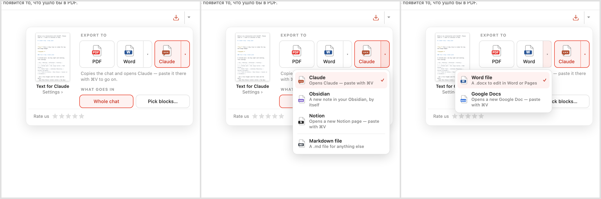

## 2026-11-18 (ночь) — 1.3.0-dev: PDF · Word ▾ · Claude ▾ в продукте

**Автор:** «Давай, сделай 30-ю версию. Dev» (понято как 1.3.0: меню перестраивается заметно).

Сделано по макету `kadry/2026-11-18-split/`: плитки Word и Claude — со стрелкой-сегментом справа и списком; плитка показывает,
что выбрано в ней последним (Obsidian выбрал — в меню «PDF · Word · Obsidian», значок свой). Списки:
- Word ▾ — Word file · Google Docs (на плитке «Docs»: «Google Docs» не влезает в треть меню);
- Claude ▾ — Claude · Obsidian · Notion · Markdown file.
Список висит ниже края панели; закрывается щелчком мимо и Esc. Карточка в конце — «Ready for Notion / Google Docs / Obsidian»
с кнопкой «Copy and open …», как у Claude.

Меню · список «куда» · список Word (Google Docs выбран):
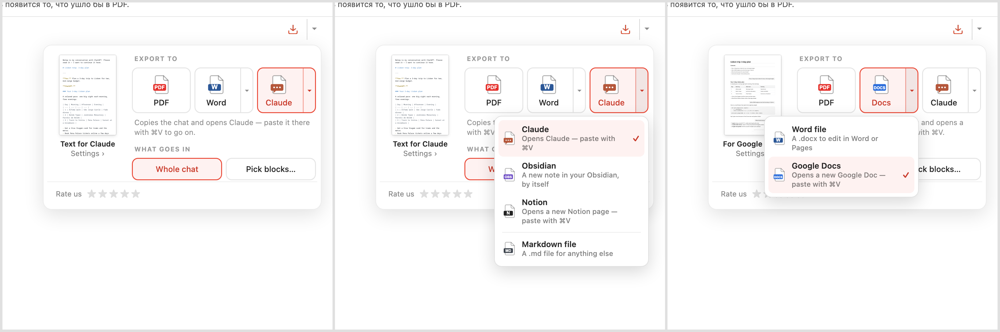
Тёмная тема, выбран Obsidian:
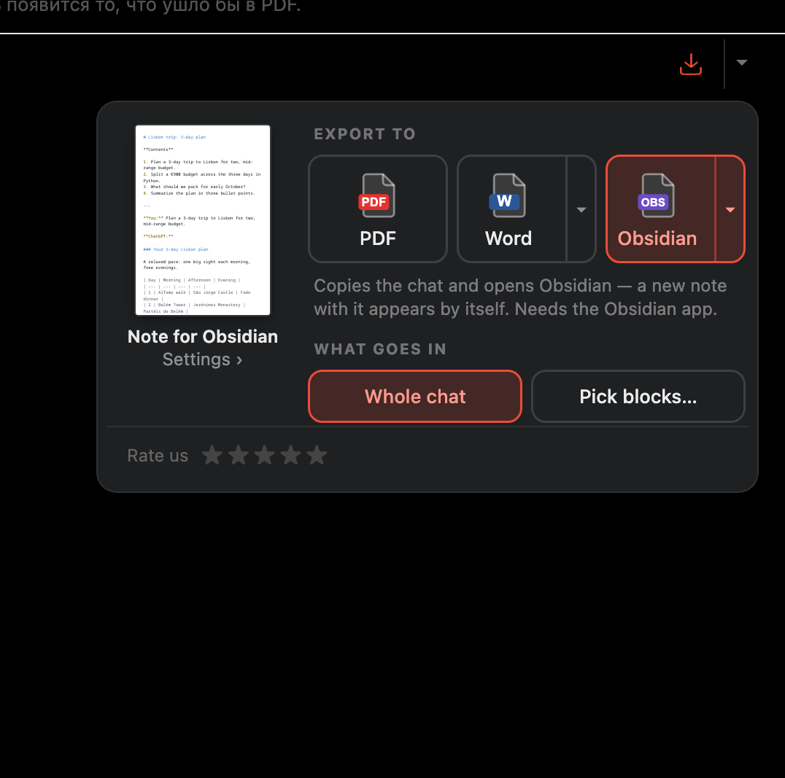
Окно настроек при Google Docs и при Obsidian:
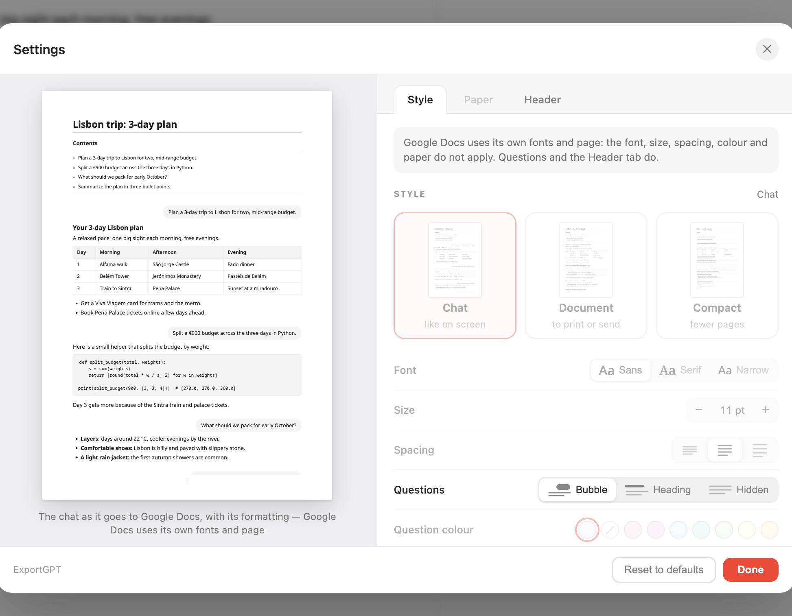

## 2026-11-18 (ночь) — после выбора места: кольца у кнопки Export

**Автор:** «выбрал Docs, и непонятно, куда дальше жать… может быть, при нажатии на эту кнопку уже, чтобы скачивалось… Или…
подсвечивается кнопка экспорт, как бы обучающая… Или… выбрал вместо PDF Docs, и у тебя сразу же ушёл в экспорт Docs. Как
думаешь, как разумно?»

Сделано в дев (предложение Клода — его же первый вариант): выбрал новое место — вокруг кнопки Export дважды, один раз
расходятся те же кольца, что зовут к кнопке при первом запуске. Меню не закрывается: «What goes in» ещё можно выбрать. Экспорт
по щелчку плитки — нет: выбор не действие, длинный чат читается минутами, и «Pick blocks…» после такого щелчка опоздал бы.

## 2026-11-18 (ночь) — предложение: кнопка «делать» внутри меню

**Автор:** «Я же не обязан догадаться, что мне нужно ещё раз нажать на кнопку «Экспорт»… Я уже здесь глазами внутри этой модалки…
нажал Whole chat, ничего не случилось… Pick blocks… нажимаю… и сразу в загрузку режима по блокам… запутался… Может быть… yes, no»;
и следом: «или… сразу ему это давали?… слишком внезапно… Буду бояться уже куда-то нажимать».

Предложение (накладка в стенде `?menuvar=go[&pick]`, продукт не тронут): выбор в меню безопасен и сам ничего не делает; делает
одна красная кнопка внизу меню — «Export to Google Docs»; выбрал «Pick blocks» — на ней «Pick blocks for Google Docs →», и только
она начинает выбор блоков. Кольца у Export тогда не нужны (глаза в меню). Окно «вы уверены?» не нужно: опасных щелчков нет.

Whole chat · Pick blocks:
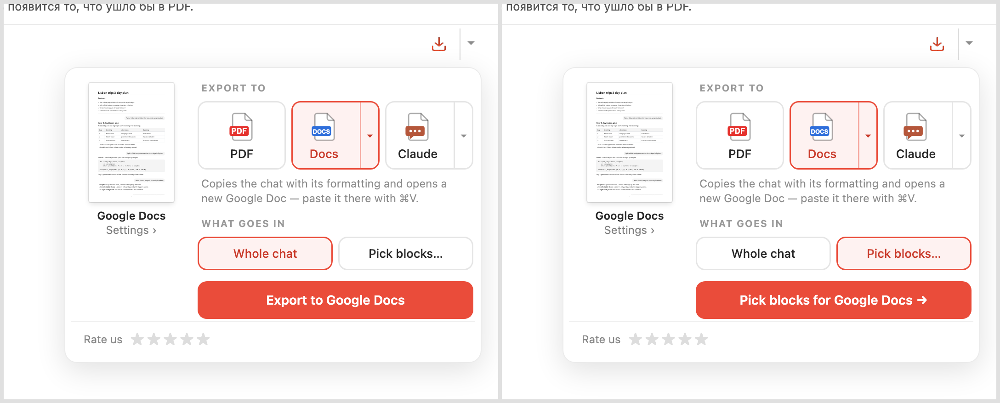

## 2026-11-18 (ночь) — кнопка «делать» в меню — в продукте

**Автор:** «отличная идея. Мне нравится, что появляется кнопка при выборе… эта же кнопка будет такой же, как и теперь экспорт?»
Ответ: место помнится — главная кнопка Export сверху делает то же место; «Pick blocks» не помнится — разовый выбор на этот чат,
главная кнопка всегда берёт весь чат.

Сделано: внизу меню красная «Export to Google Docs» (имя места меняется с выбором); «Pick blocks…» только выбирает — на кнопке
«Pick blocks for Google Docs →», выбор блоков начинается ею; пока блоки выбираются — «Export the picked blocks»; ✕ или
«Whole chat» — обратно к «Whole chat». Кольца у Export убраны. Проверено щелчками на стенде: выбор не запускает ничего, кнопка
запускает экспорт и выбор блоков, после ✕ — снова весь чат.

Светлое (Google Docs) · тёмное (Claude):
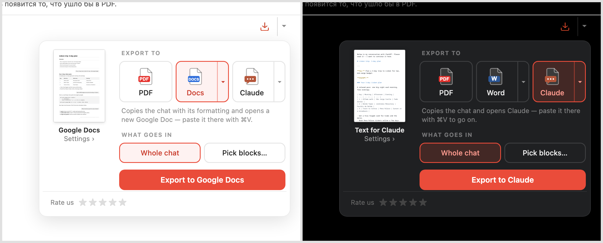

## 2026-11-25 — Скриншоты CWS: красный напрягает (обсуждение, ждёт выбора автора)

**Автор** (1.3.2 прошла модерацию, смотрит страницу магазина): «оранжевый весьма неплохой цвет… яркий… соответствует кнопке
самого расширения»; «красный на трёх страницах баннера — вот он меня напрягает… туда глаза как будто не хочется погружать.
Именно из-за этой красноты».

**Замер** (живая страница 25.11, файлы трёх слайдов; $0):
- на слайдах не оранжевый, а красный — тот же, что у кнопки Export (`#EA4C3A` → `#c0392b`, оттенок 6°): поле слайдов —
  оттенок 6–12°, к низу тёмно-красный `#d6321f`. Оранжевый у нас есть только в иконке (верх `#fd9d3f` → низ малиновый
  `#ff1548`) и в маленькой плитке 440×280 (`#fd7306` → `#fd3d29`);
- красное поле занимает 51 % · 42 % · 22 % кадра (слайды 1 · 2 · 3). На кнопке тот же цвет — точка;
- белый текст на этом красном — 3,1–4,8:1; на оранжевом иконки — 2,1–2,6:1 (крупному заголовку нужно ≥3:1);
- карточки в списках магазина показывают маленькую плитку (на нашей странице «похожие» — картинки 275×175, её пропорция);
  скриншоты видит тот, кто уже открыл страницу;
- слайд 3 («Export only what matters») — картинка генератора: рамки выбора красные, а в продукте с 17.11 синие (слово автора
  17.11), в списке источников бессмыслица («Flysis aheef…», «Puterint (2019)»), видна при открытии во весь размер.

**Кадр для разговора** (`banner/2026-11-25-cvet/`, `kadr.sh`; слайд 2 — тот, что из HTML, меняется только цвет):
сейчас · А — оранжевый иконки, заголовок тёмный · Б — светлое тёплое поле, тёмный заголовок, цвет кнопки только акцентом
(подписи плиток, стрелка, полоска внизу). Совет — Б: причина в площади, не в оттенке. В стор не идёт.
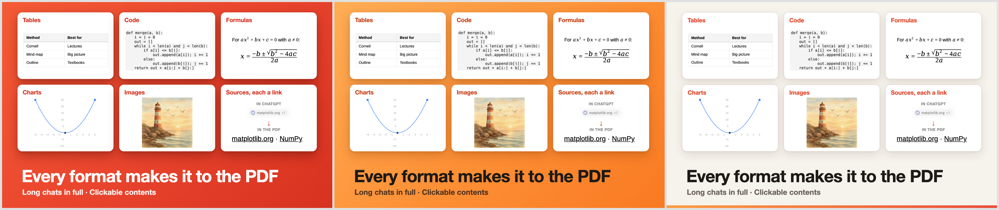
**Автор (следом):** «Б гораздо менее напряжно выглядит. Давай его возьмём».
**Стало** (`banner/2026-11-25-svetloe/`, `kadr.sh`): все три слайда стора в варианте Б — те же кадры, сменён цвет.
- Слайд 1 «Export ChatGPT to PDF» — растр живого слайда, поле перекрашено `perekras.py`: окно с его полупрозрачным краем,
  плашка Export, лист PDF с красной шапкой, тени — свои. Белая стрелка на светлом пропала бы — обведена по тем же точкам
  цветом кнопки. Заголовок, «in one click» и три плашки фич — тот же текст, тёмным; «1 / 2» на листе — как было.
- Слайд 2 «Every format makes it to the PDF» — ровно Б с кадра сравнения.
- Слайд 3 «Export only what matters» — то же перекрашивание; рамки выбора и заливка — из красного в синий продукта
  `#2F6FED` (с 17.11 выбор синий); бессмыслица генератора под таблицей («Flysis aheef…») → три обычных совета про сон.
Было (сверху) · стало (снизу):
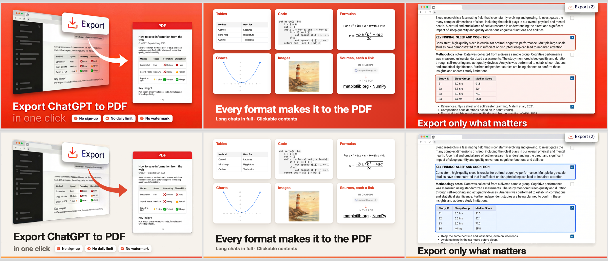
