# Ревью: вид PDF и настройки — 16.11.2026

**Повод.** 16.11 пришла оценка 1★ с жалобой на вид PDF. Жалоба на вид не первая: см. `ГОЛОСА.md` (07-11, 07-21, 15.11).
**Слово автора 16.11:** вернуться к вёрстке и настройкам и сделать ревью. Выбора шрифта нет нигде. Логику настроек
Fill in the Blank (стиль-пресет, а под ним свои настройки) перенести сюда.

**Как смотрели.** Взяли демо-чаты живого стенда: `tests/blockmode-live-stand.html` с параметрами `?demo=1`,
`?demo=formats` и `&pagetheme=newdark`. Прогнали их через настоящий `background.js` на наш сервер
(`tests/e2e-render.js`) с настройками по умолчанию на листе A4. Какие шрифты попали в PDF, прочитано из самого файла.
Кадры лежат в `kadry/`.

## 1. Что человек получает сейчас

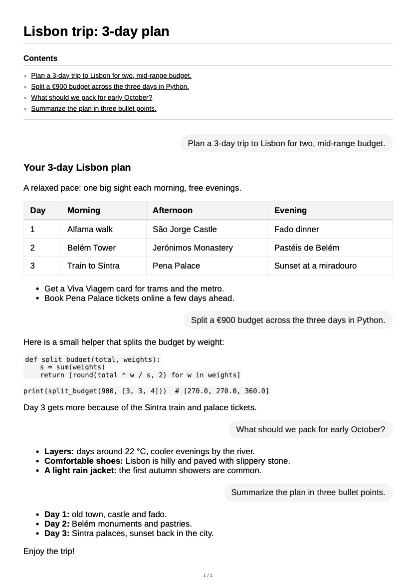

1. **Шрифт — копия Arial, и никто его не выбирал ✅.** Стили просят шрифты Mac и Windows (`render.js:40`: `-apple-system`,
   `Segoe UI`, `Roboto`, `Helvetica`, `Arial`). На сервере (Linux) их нет, и он подставляет Liberation Sans — копию Arial.
   Так у всех, на любом компьютере. Код выходит шрифтом DejaVu Sans Mono, формулы — копией Times.
2. **Узкие поля и длинная строка ✅.** Поля по умолчанию — 0,4 дюйма, это около 10 мм; у Word и Google Docs — 25 мм.
   В строке около 100 знаков (замер по кадру). Удобной для чтения считают строку в 45–75 знаков (Bringhurst,
   «The Elements of Typographic Style»). Вместе выходит вид распечатанной веб-страницы, а не документа.
3. **Вопрос не держится за свой ответ ✅.** Вопрос стоит так же близко к чужому ответу над ним, как к своему под ним.
   После таблицы он прилипает к ней вплотную (кадр ниже). Глаз не видит пар «вопрос — ответ».
4. **Тёмный ChatGPT даёт чёрный PDF ✅.** Тема по умолчанию — «Auto»: у кого ChatGPT тёмный, тот получает чёрные
   страницы (`common.js:346`). Для печати и пересылки это странно. Сколько таких людей, мы не знаем ⬜.
5. **Блок кода — серый фон полосами по строкам.** В коде есть перестройка блока (`render.js`, `createCodeBlock`:
   рамка `#3a3a3a`, Courier New), **но в экспорте она не срабатывает ✅ (по коду, поправка 16.11):** она пропускает
   узлы вне документа (`isConnected`), а копия чата для PDF в документ не вставлена (`prepareSelection` кладёт её в
   отдельный `<main>`). Поэтому в PDF выходит сырой блок ChatGPT, у которого серый фон стоит на самом `<code>` —
   отсюда рваный по строкам фон на кадрах. Так и на стенде, и, по коду, на настоящей странице. Кадра с
   настоящего чата нет ⬜.
6. **Оглавление и ссылки подчёркнуты** — это тоже вид веб-страницы 🔶 (дело вкуса).

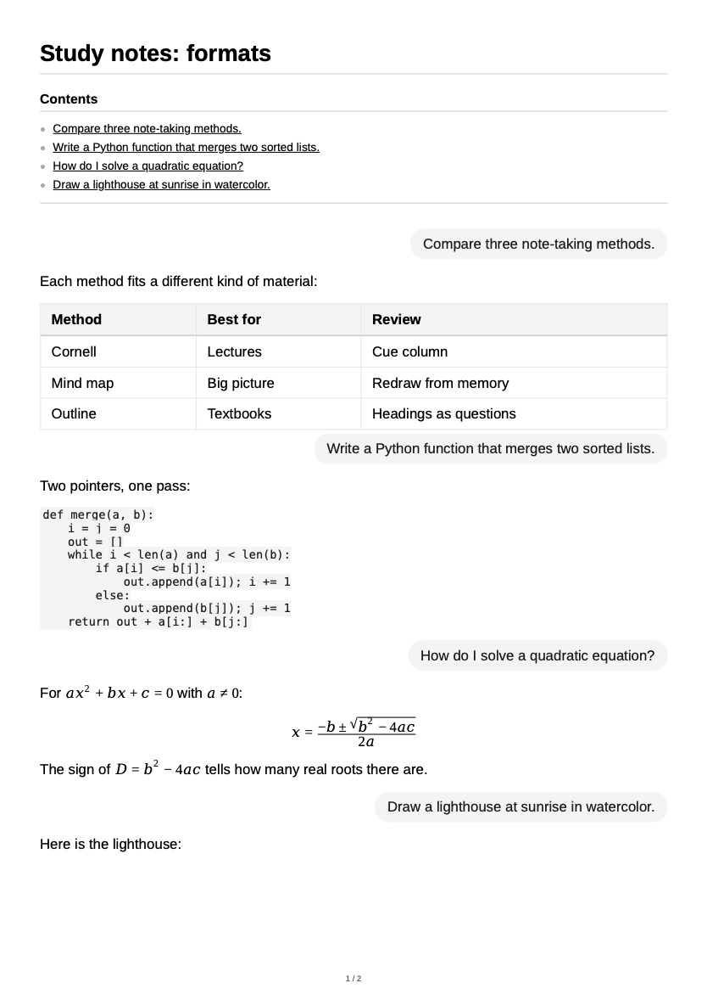

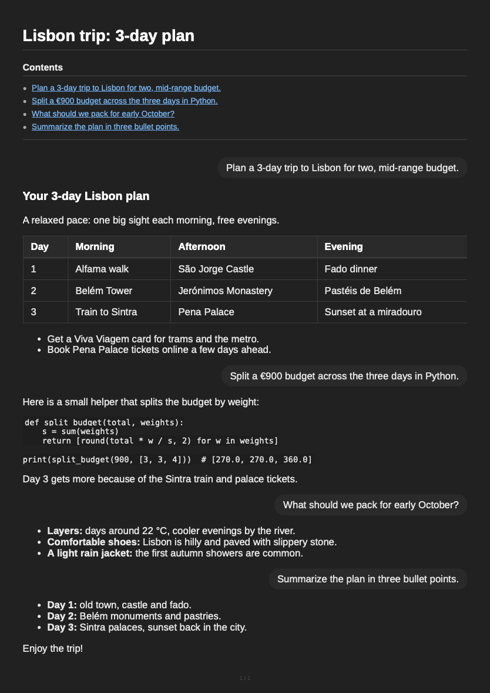

## 2. Какие шрифты есть на сервере (замер 16.11) ✅

**Есть:**
- Noto Sans, Noto Serif, Noto Sans Mono;
- Carlito (как Calibri) и Caladea (как Cambria);
- Liberation Sans, Serif и Mono (как Arial, Times и Courier);
- DejaVu Sans, Serif и Mono.

Китайский, японский, корейский, эмодзи, иврит, арабский, хинди, тайский, греческий и грузинский рисуются без
квадратиков (`kadry/server-alfavity.png`).

**Нет:** Roboto, Inter, Open Sans, Lato, Source Sans и Source Serif, IBM Plex, Merriweather.

**Вывод.** Выбор из трёх шрифтов можно дать без работ на сервере. Для любого другого шрифта есть два пути: поставить
его на сервер (руками автора по ssh) или вшивать в каждый PDF (файл станет тяжелее).

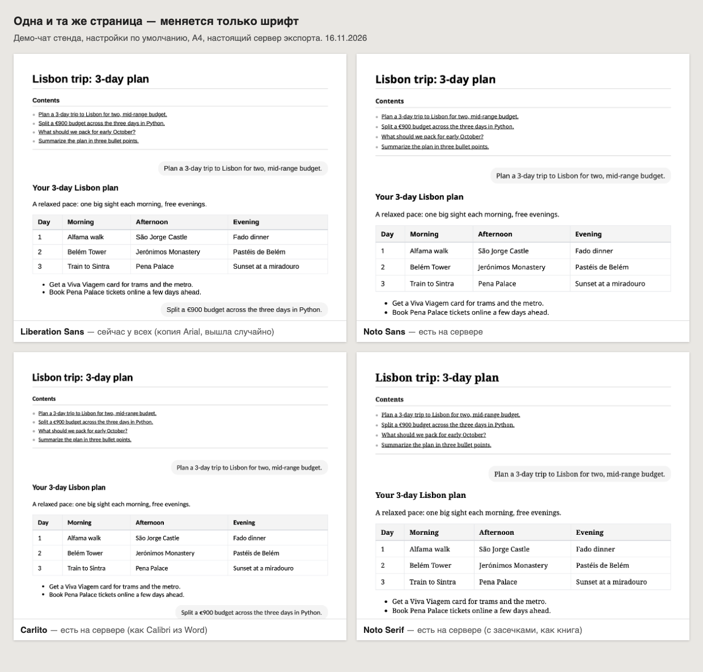

Шрифт меняет характер страницы, но один он вид не спасёт: поля, длина строки и ритм «вопрос — ответ» весят не меньше 🔶.

## 3. Настройки сейчас

В окне Settings 12 пунктов в двух группах (`kadry/nastrojki-sejchas.png`). Кроме них в меню кнопки выбирается, что
выгружать: Everything, AI-only или Select to export.

| Группа | Пункт | Варианты | По умолчанию |
|---|---|---|---|
| Output format | Page size | A4 · Letter; книжная · альбомная | по стране |
| | Color theme | Auto · Light · Dark | Auto (тёмный ChatGPT → чёрный PDF) |
| | Question color | 9 цветов пузыря вопроса | серый |
| | Font size | ползунок 70–200 % | 100 % |
| | Margins | Default (≈10 мм) · Minimal (≈2,5 мм) · Custom | Default |
| | Page breaks | Auto · After each answer | Auto |
| | Page numbers | вкл / выкл | вкл |
| | Single page | вкл / выкл | выкл |
| Document info | PDF Title | Chat name · Ask me · None | Chat name |
| | Export date | None · Date · Date & time | None |
| | Table of contents | None · Standard · Numbered | Standard |
| | Source link | вкл / выкл | выкл |

В коде хранятся ещё четыре ключа, которых нет в окне: выравнивание и скругление пузыря, цвет текста вопроса и значки
(`shared.js`, `defaultOptions`). Это остатки прежних версий.

**Что видно из таблицы:**
- о шрифте нет ни слова;
- девять цветов пузыря — украшение, а то, от чего вид зависит больше всего (шрифт, поля, интервал), спрятано или отсутствует;
- «Font size» на деле масштабирует всё сразу в процентах, а не задаёт размер шрифта.

## 4. Как это устроено в Fill in the Blank

Подробно — в `fill-in-the-blanks/DECISIONS.md` (25–27.09) и `fill-in-the-blanks/dizajn/KOD.md`.

- **Стиль печати** — три плитки с маленькой картинкой страницы. Имя говорит о назначении: Standard («everyday»),
  Large («young · new»), Compact («fewer pages»). Плитка задаёт сразу шрифт, размер и интервал.
- **Под плитками всегда видны три ручки:** шрифт (Sans · Serif · School), размер (10–18 pt) и интервал. Стоит тронуть
  любую, и стиль становится своим: плитки гаснут, а вместо имени стиля появляется терракотовая метка «Custom»
  с подсказкой, что щелчок по стилю вернёт его. Вернуться можно только щелчком по плитке.
- **Остальное от стиля не зависит:** раскладка, шапка и бумага живут отдельными группами.
- **Законы, на которых это стоит:**
  - одна настройка — одно место;
  - где можно без чтения, там без чтения;
  - шрифтов не больше трёх (закон Хика: чем больше вариантов, тем дольше выбор);
  - терракота отмечает отход от готового.

## 5. Набросок для ExportGPT — новое, на решение автора

Сколько людей открывает окно настроек, мы не знаем: счётчика нет ⬜. Вид по умолчанию видят все, поэтому он лечится первым,
а стили дают выбор тем, кто окно откроет.

**Шаг 1 — основа. Её увидят все:**
- настоящий шрифт вместо случайной копии Arial;
- поля шире, около 18–20 мм, и строка от этого короче;
- перед вопросом больше воздуха, чем после него, — тогда пары видны;
- блок кода — светлая коробка без тёмной рамки, моноширинный шрифт с сервера;
- ⬜ тема: светлый лист по умолчанию, а тёмный — по выбору? Решает автор.

**Шаг 2 — стили, как в Fill in the Blank.** Три плитки с картинкой страницы (имена черновые):
- **Chat** — как в ChatGPT: вопросы пузырями справа, шрифт без засечек; чтобы читать с экрана;
- **Document** — как отчёт: шрифт с засечками, вопрос заголовком слева, поля шире; чтобы печатать и пересылать;
- **Compact** — меньше страниц: мельче, плотнее, без оглавления; для длинных чатов.

Под плитками — шрифт (три на выбор), размер и интервал; первое касание включает «Custom». Остальное живёт
отдельно и от стиля не зависит.

**Куда переедут нынешние пункты:**

| Сейчас | Куда |
|---|---|
| Font size (масштаб в %) | ручка «размер» под стилем, в пунктах |
| Margins | внутрь стиля; Custom — в группу «Бумага» |
| Question color (9 цветов) | внутрь стиля (пузырь есть только у Chat); оставлять ли отдельный выбор — ⬜ |
| Color theme | ⬜ см. шаг 1 |
| Page size, ориентация | группа «Бумага» |
| Page breaks, Page numbers, Single page | группа «Страницы» |
| PDF Title, Export date, Table of contents, Source link | группа «Шапка документа» (сейчас Document info) |

## 6. Что решить автору

1. **Порядок.** Сначала основа (шаг 1, одна версия), потом стили — или всё сразу. Совет: основу первой, её увидят все.
2. **Тёмная тема.** Оставить «как в ChatGPT» по умолчанию или сделать лист светлым по умолчанию, а тёмный — по выбору.

**Следующий шаг после решения:** кадры «было → стало» шага 1 на этом же стенде, глазами автора, и только потом код.

## Как пересобрать кадры

Нужен сервер стенда `exportgpt-stend` (порт 8840).
1. Снять выгрузку стенда: headless Chrome с `--dump-dom` по адресу `tests/blockmode-live-stand.html?auto=export&demo=1`
   (команда — в шапке `tests/e2e-render.js`).
2. Получить PDF с нашего сервера: `node tests/e2e-render.js <выгрузка> <out.pdf>`.
3. Только для сравнения шрифтов: `python3 -I tools/shrift.py <выгрузка> <новая выгрузка> "Noto Serif"`. Это подмена
   шрифта в выгрузке, в код расширения она не идёт; дальше снова шаг 2.
4. Нарисовать страницы: `swift tools/pdf2png.swift <out.pdf> <префикс> 1.4`.
Какие шрифты в PDF — имена `/BaseFont` внутри файла.

## 7. Основа: набросок после решения автора (16.11)

Решения автора 16.11 (`DECISIONS.md`): сначала основа; лист светлый при любой теме ChatGPT; вход в настройки —
миниатюра листа (это шаг 2).

**Что меняет набросок** (`tools/osnova.py` — подмена стиля в выгрузке стенда; в код расширения она пока не идёт):
- шрифт Noto Sans, код — Noto Sans Mono; оба уже есть на сервере;
- текст 11 pt, межстрочный интервал 1,55; было 12 pt и браузерные ≈1,15;
- поля 20 мм по бокам и 18 мм сверху и снизу; было ≈10 мм;
- перед вопросом 20 pt воздуха, после него 6 pt; таблицы, формулы и код отделены от соседей;
- блок кода — светлая коробка без тёмной рамки;
- оглавление без подчёркиваний;
- лист светлый (тёмный — только если выбран нарочно, ⬜ см. ниже).

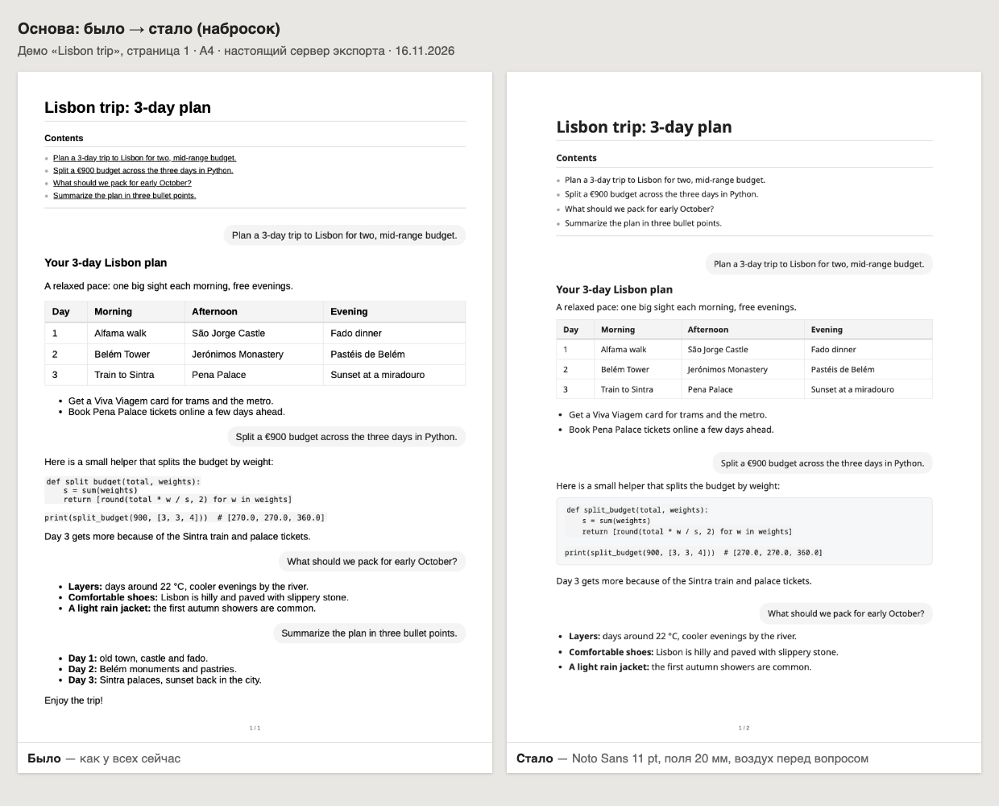

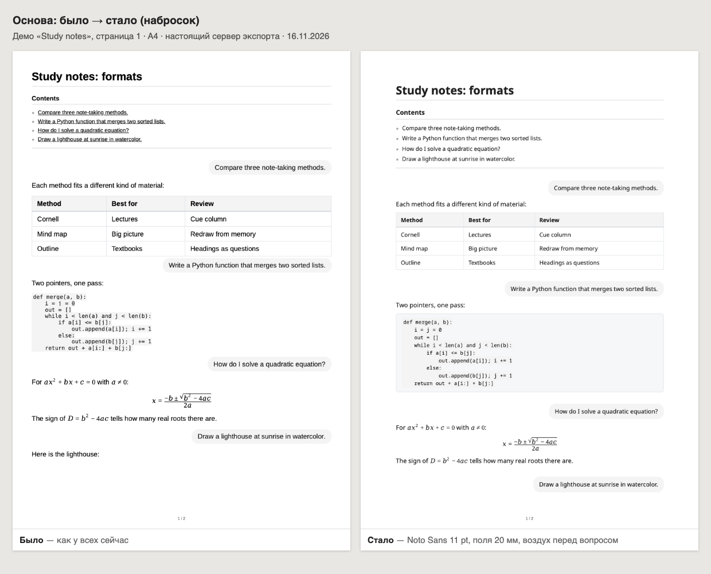

**Цена 🧮.** На странице помещается меньше текста. Сплошной текст: было ≈57 строк × ≈100 знаков, стало ≈43 × ≈85.
Длинный чат станет примерно в полтора раза длиннее по страницам; демо «Lisbon trip» — 2 страницы вместо 1. Для
тех, кому важны страницы, в шаге 2 будет стиль Compact.

**Осталось решить автору:**
1. Тёмный лист: оставить осознанным выбором в настройках или убрать совсем.
2. Цена в страницах приемлема, или основу сделать плотнее (например, 10,5 pt и интервал 1,45).

## 8. Макет окна настроек (шаг 2), v1 — 16.11

**Слово автора 16.11:**
- «Сделай макет страницы настроек. Как ты это видишь?»
- Тёмный лист оставить выбором: «может быть полезен, только если человек читает с устройства».
- Основа принята: «выглядит красиво… чистенько».
- Цена в страницах приемлема: «пусть дефолтный пресет будет красивым и хорошим».

**Где.** `maket/nastrojki.html`, открывать по http при запущенном сервере стенда:
http://localhost:8840/dizajn/obzor-2026-11-16/maket/nastrojki.html (в Safari тоже). Внизу слева полоса макета:
тема ChatGPT, «меню», «окно». Параметры для кадров — в шапке файла. Это макет, код расширения не тронут.

**Как устроено:**
1. **Вход — миниатюра листа в меню Export.** На ней первая страница этого чата в выбранном виде. Под ней стиль и
   бумага: «Chat · A4 · Settings ›». Щелчок открывает окно. Три пункта меню (Select all · AI answers only ·
   Select to export) не менялись.
2. **Окно: слева большой лист** — та же первая страница, меняется от каждого щелчка. **Справа три закладки:**
   - **Style** — три плитки и под ними ручки: шрифт, размер, интервал, вид вопроса, цвет вопроса;
   - **Paper** — бумага, лист светлый или тёмный, поля, разрывы страниц, номера страниц;
   - **Header** — заголовок, дата выгрузки, оглавление, ссылка на чат.
3. **Плитка рисует то, что получится, если её нажать:** свой стиль, твоя бумага и шапка.
4. **Тронул ручку под плитками — стиль стал своим.** Плитки гаснут, у той, от которой ушёл, пунктир. Вверху
   метка «Custom · ↺ Chat»: щелчок по ней или по любой плитке возвращает готовый стиль. Так сделано в Fill in the
   Blank: метка отклонения и возврат щелчком.
5. **Изменения применяются сразу:** «Done» просто закрывает окно, «Reset to defaults» возвращает Chat и обычную
   бумагу и шапку.

**Стили — значения черновые:**

| Стиль | Шрифт | Размер | Интервал | Вопрос | Цвет вопроса |
|---|---|---|---|---|---|
| **Chat** (умолчание = принятая основа) | Noto Sans | 11 pt | 1,55 | пузырь справа | серый |
| **Document** | Noto Serif | 11 pt | 1,55 | жирная строка слева | без фона |
| **Compact** | Carlito (как Calibri, узкий) | 10 pt | 1,3 | жирная строка на сером | серый |

Демо «Lisbon»: Chat и Document — 2 страницы, Compact — 1.

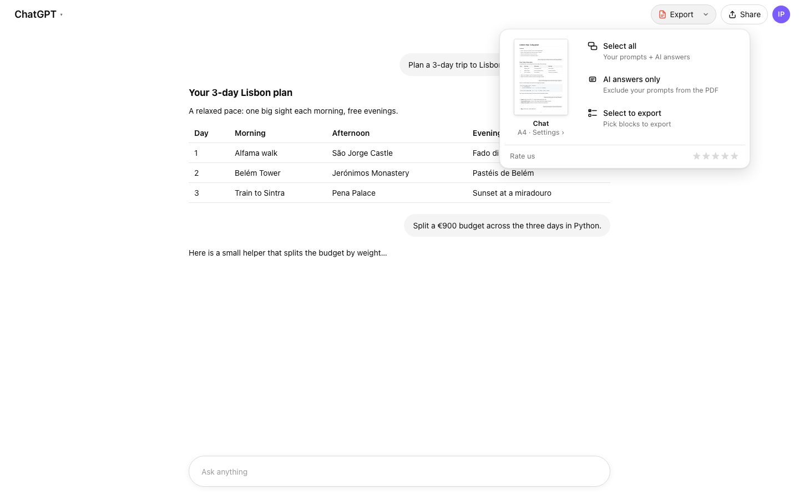

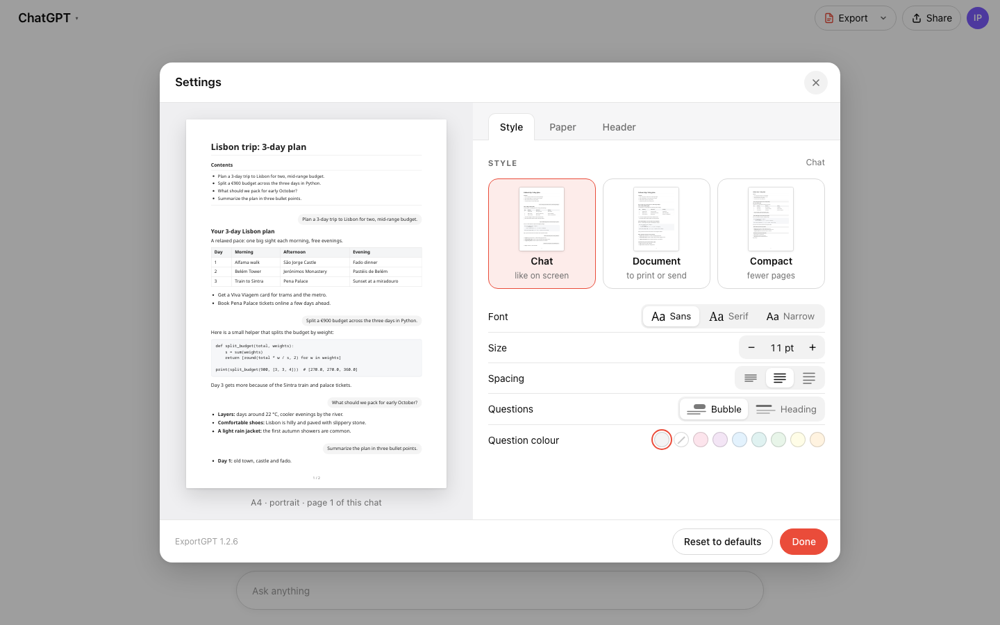

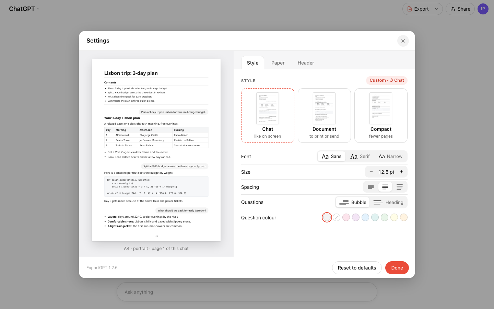

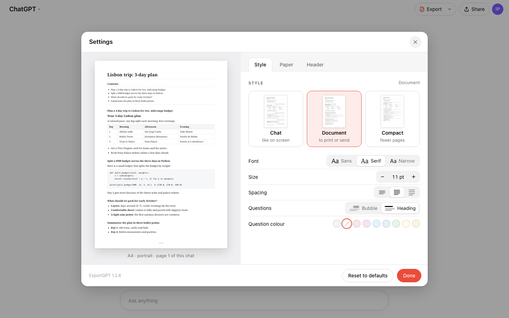

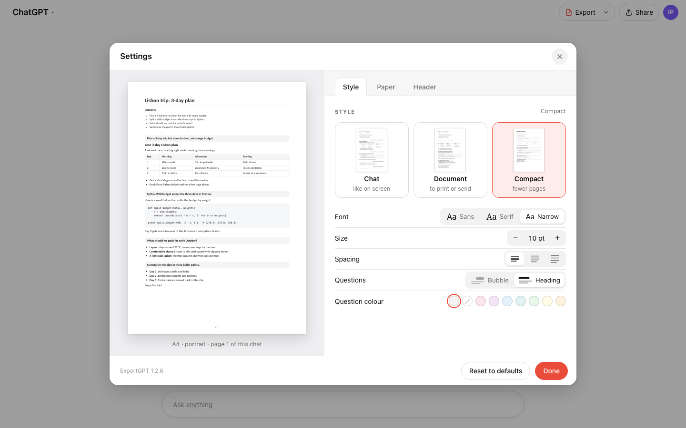

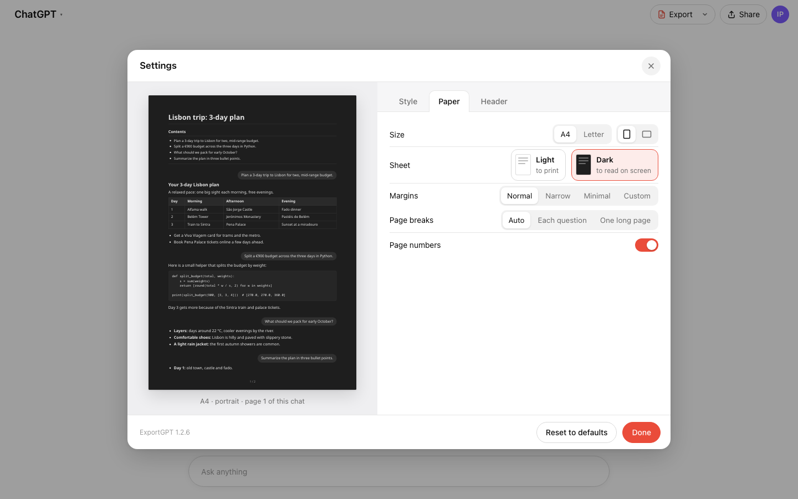

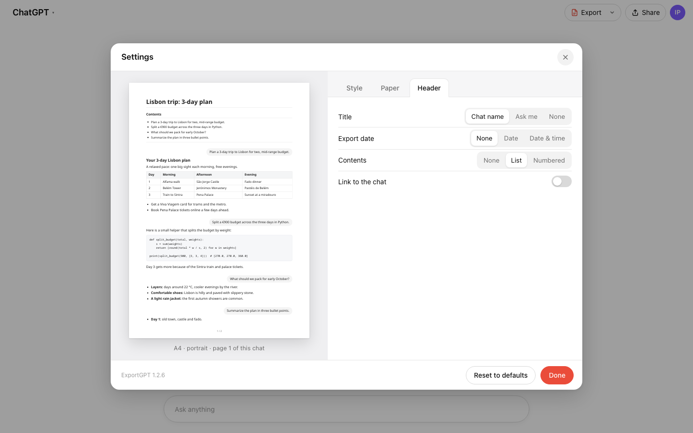

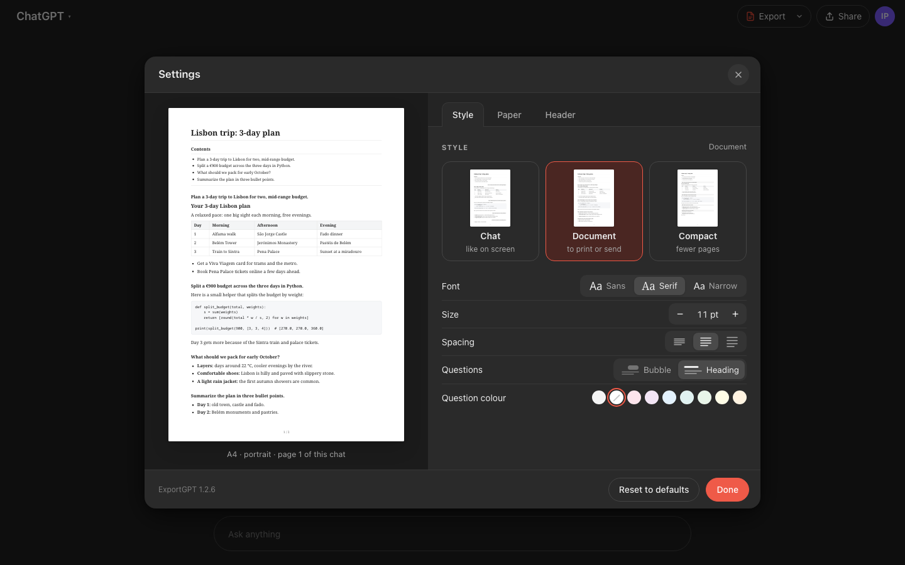

**Куда переехали нынешние пункты:**

| Сейчас | В макете |
|---|---|
| строка «Settings ›» в меню | миниатюра листа в меню |
| Page size, ориентация | Paper → Size |
| Color theme: Auto · Light · Dark | Paper → Sheet: Light · Dark. Auto убран: лист светлый при любой теме ChatGPT (решение 16.11) |
| Question color (9 цветов) | Style → Question colour, те же 9 |
| Font size 70–200 % (масштаб всего листа) | Style → Size 9–14 pt, только текст. Картинки больше не растут; терять ли это — ⬜ |
| Margins: Default ≈10 мм · Minimal · Custom (дюймы) | Paper → Margins: Normal 20 мм (новое умолчание) · Narrow 10 мм (бывшее умолчание) · Minimal · Custom (мм; для Letter — дюймы ⬜) |
| Page breaks: Auto · After each answer | Paper → Page breaks: Auto · Each question |
| Single page | Paper → Page breaks: One long page. Номера страниц на нём гаснут с подсказкой |
| Page numbers | Paper → Page numbers |
| PDF Title · Export date · Table of contents · Source link | Header → Title · Export date · Contents (None · List · Numbered) · Link to the chat |
| Reset to defaults · Apply Changes | Reset to defaults · Done (изменения применяются сразу) |
| скрытые ключи `q_align`, `q_rounded` | Style → Questions: Bubble · Heading |
| скрытые ключи `q_fg_color`, `no_icons` | убрать (остатки старых версий) |

**Новое:** стили-плитки, шрифт (3 на выбор), интервал (3), вид вопроса (2).

**Чего макет не знает — решается на коде ⬜:**
- **Что рисовать на листе в окне.** На настоящем листе будет твой чат. Если начало длинного чата ещё не загружено,
  первую страницу целиком знает только экспорт. Тогда лист в окне рисуется по тому, что есть на экране.
  Автор 16.11: «надо не запутать человека». **Предложение:**
  - если начало не загружено, лист рисуется из того, что на экране, без номера страницы;
  - под листом одна строка: «Showing the part of the chat on your screen — the PDF starts from the first message»;
  - после первого экспорта этого чата расширение помнит его первую страницу (только на устройстве, ⬜ PRIVACY.md)
    и дальше показывает настоящую.
  Слово автора 16.11: «для длинного чата подходит».
- **Номер «1 / N».** В макете он настоящий для демо-чата. Сколько страниц займёт настоящий чат, до экспорта неизвестно.
- **Шрифты в окне.** Noto и Carlito есть на сервере, а в браузере человека их нет. Чтобы лист в окне совпадал с
  PDF, шрифты кладём в расширение (порядка сотен КБ) — **решено 16.11, слово автора**.
- **Safari.** Макет проверен настоящими щелчками в Chrome; в Safari его увидит только автор.

**Решить автору:**
1. **Имена и подписи плиток.** Сейчас: Chat «like on screen», Document «to print or send», Compact «fewer pages».
   Разведка интента (`research/intent-2026-11/README.md`) говорит, что первая цель людей — архив и бэкап. Отсюда
   вариант подписи для Compact: «to archive».
2. **Ручки.** Здесь они плоские, как в ChatGPT (кнопки, степпер), а не крутилки Fill in the Blank. Оставить так?
